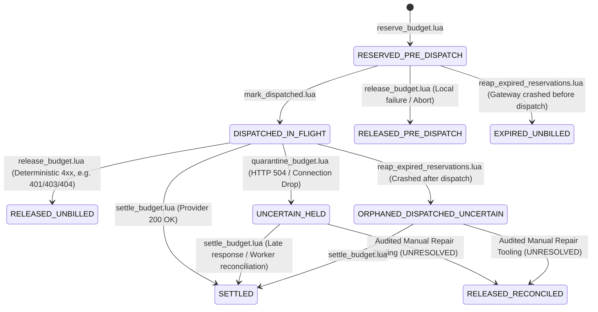

# RFC: Redis Budget Counter Contract & Real-Time Gateway Enforcement

- **Authors:** M1 (Vedant Rathod — AI Gateway) & M3 (Atharva Pawaskar — Worker / Asynchronous Pipeline)
- **Version:** 0.5.1
- **Status:** Approved Architectural Baseline (M1 & M3 Consensus on Missing-Budget Policy, Option C Reconciliation, and Cluster Stream Hash-Tags; Implementation Blocked on Pre-Implementation Gates; Contradictions Resolved in v0.5.1)
- **Target Task:** Task 3.2 Gate (Phase 3 Budget & Policy Enforcement — BLOCKED pending migration safeguards, repair safeguards, and verification gates)
- **Related Contracts:**
  - `contracts/db/budgets.v2.json`
  - `contracts/api/control-plane-budgets.v2.yaml`
  - `contracts/events/usage-event.v1.json`
  - `contracts/redis/keys.md`
  - `contracts/api/gateway-api.yaml`

---

## 1. Executive Summary & Distributed Financial Architecture

Kubefin enforces strict, sub-millisecond cost governance across multi-tenant AI workloads.
Under `contracts/db/budgets.v2.json` and `contracts/api/control-plane-budgets.v2.yaml`, currency-specific budget limits (`daily` or `monthly`, `hard` or `alert_only`) are configured in MongoDB.

### The Distributed Challenge: Synchronous Admission vs. Asynchronous Ingestion Lag
In the analytics pipeline, spend is calculated by the Worker consuming the Redis Stream `usage-events` and persisting enriched records into MongoDB `usage_events`.
Under production burst traffic, stream consumption and database indexing lag Gateway traffic by 50ms to several seconds.
If the Gateway relied purely on asynchronous Worker-computed MongoDB spend for admission control:
- High-concurrency bursts would pass admission checks simultaneously before any spend is reflected.
- Hard enterprise budgets would be breached by orders of magnitude before the first usage event is persisted.

### The Dual-System Architecture
To solve this without sacrificing low latency or financial auditability, Kubefin enforces a strict separation of concerns:
1. **System of Record (Historical / Financial Ledger):** **MongoDB `usage_events`** is the sole audited source of truth for invoicing, enterprise accounting, and historical rollups.
2. **Operational Admission Cache (Real-Time Synchronous):** **Redis** maintains sub-millisecond in-memory spend counters and active reservations to enforce hard limits *before* requests are dispatched to upstream LLM providers.
3. **Reconciliation Bridge:** A multi-dimensional, currency-aware reconciliation routine continuously audits Redis operational counters against MongoDB historical totals and heals drift without disrupting live traffic.

---

## 2. Core Architectural Protocols & Decision Resolution

### Protocol 1: Crash-Safe Lifecycle & Dispatch State Machine

#### The Flaw of Blind Expiry
A fundamental flaw in naive distributed reservation designs is releasing an expired reservation merely because a deadline passed.
If a Gateway process reserves budget, transmits request bytes to an upstream provider (OpenAI, Anthropic, or Google Gemini), and then crashes or loses network connectivity while awaiting the completion:
- The upstream provider backend may complete token generation and bill Kubefin for the request.
- If a background reaper blindly decrements `budget:reserved` and marks the reservation expired merely because a 120-second timer elapsed, the reservation is released while provider costs are actively incurred.
- This creates an unmetered financial leak where crashed or timed-out requests escape budget accounting.

#### Lifecycle State Machine
To guarantee crash safety, the reservation lifecycle strictly separates **pre-dispatch** from **post-dispatch** states:



#### Detailed State Definitions
1. **`RESERVED_PRE_DISPATCH`:**
   - Reservation recorded in Redis by `reserve_budget.lua`.
   - Invariant: Zero network bytes have been transmitted to the upstream provider.
   - If local validation, authentication, rate limiting, or circuit breaking fails, Gateway calls `release_budget.lua`, releasing `budget:reserved` immediately to state `RELEASED_PRE_DISPATCH`.
   - If the Gateway crashes before dispatch, the active reaper detects deadline expiry in `RESERVED_PRE_DISPATCH`.
     - If `current_reserved >= amount`: The reaper safely decrements `budget:reserved`, marks `EXPIRED_UNBILLED`, sets `reapedAt`, sets window retention TTL, and removes the entry from `budget:res_expiry`.
     - If `current_reserved < amount` (Invariant Underflow): The reaper **MUST NOT** silently skip or clamp to zero, and **MUST NOT** mutate `budget:reserved` or mark the record expired. It records `lastInvariantError = 'UNDERFLOW_ON_REAP'`, advances the score by 60s, increments `invariant_count`, and triggers Prometheus alert `gateway_budget_reaper_invariant_violations_total`.
2. **`DISPATCHED_IN_FLIGHT`:**
   - Transitioned atomically by `mark_dispatched.lua` immediately before Gateway invokes the upstream provider network call.
   - Invariant: Request bytes have been or are being transmitted. The upstream provider may execute inference.
   - If the Gateway crashes while in this state, the reaper **MUST NOT release the reservation**. The reaper transitions the record to `ORPHANED_DISPATCHED_UNCERTAIN` and retains the reservation in `budget:reserved`.
3. **`UNCERTAIN_HELD`:**
   - Upstream provider call returned HTTP 504 Gateway Timeout, connection reset, or client aborted during generation.
   - Invariant: Provider billing status is unknown. The reservation remains **HELD** in `budget:reserved`.
   - The 15-minute review window is a **Reconciliation Review Deadline**, NOT a key retention TTL.
4. **`ORPHANED_DISPATCHED_UNCERTAIN`:**
   - Gateway crashed after dispatching bytes upstream; detected by reaper.
   - The reservation remains **HELD** in `budget:reserved` pending audited manual reconciliation / operator investigation under writer fencing.
5. **`SETTLED`:**
   - Settled at actual integer micro-spend via `settle_budget.lua`.
   - Reservation decremented; cumulative `budget:spend` incremented.
6. **`RELEASED_PRE_DISPATCH` / `RELEASED_UNBILLED`:**
   - Confirmed unbilled. Reservation decremented; zero spend added.
7. **`RELEASED_RECONCILED` (UNRESOLVED Lifecycle Transition):**
   - **Autonomous Script Prohibited:** Autonomous background release scripts (such as speculative `reconcile_release_budget.lua`) are **PERMANENTLY REJECTED** under Option C.
   - **Audited Manual Repair Only:** Transition from `UNCERTAIN_HELD` or `ORPHANED_DISPATCHED_UNCERTAIN` to `RELEASED_RECONCILED` is permitted strictly through authorized manual repair tooling after:
     1. Operator verifies non-billing proof from the upstream provider.
     2. Scope-wide distributed lock `budget:recon:lock:{budget:...}` is acquired.
     3. Gateway writes for the scope are verified fenced/drained.
   - Because the manual repair tooling contract and operator workflow have not been approved, this transition is **UNRESOLVED** and serves as an explicit pre-implementation gate for Task 3.2. Until then, reservations remain held in `budget:reserved`.

#### Audited Recovery for Missing or Corrupted Expiry Entries
- If an entry exists in `budget:res_expiry` whose corresponding `budget:req` record is missing, corrupted, or in an unknown state:
- The reaper **MUST NOT silently remove it (`ZREM`)**. Silently removing entries destroys evidence needed by reconciliation to identify drifted reservations.
- Instead, the reaper advances the entry's score in `budget:res_expiry` by 1 hour (`now + 3600000ms`), records `lastInvariantError = 'CORRUPTED_OR_MISSING_REQUEST_RECORD'`, increments `corrupted_count`, and emits alert `REAPER_CORRUPTED_ENTRY_DETECTED` to preserve the audit trail for reconciliation.

#### State Transition & Invariant Matrix

| Current State | Event / Trigger | Lua Script | Next State | `budget:reserved` Mutation | `budget:spend` Mutation | `budget:res_expiry` Action | Idempotent Replay Outcome |
|---|---|---|---|---|---|---|---|
| `None` | Admission Check | `reserve_budget.lua` | `RESERVED_PRE_DISPATCH` | `+reservation` | None | `ZADD deadline` | `ALLOWED` |
| `RESERVED_PRE_DISPATCH` | Client Retry (matching) | `reserve_budget.lua` | `RESERVED_PRE_DISPATCH` | None | None | None | `ALREADY_RESERVED` |
| `RESERVED_PRE_DISPATCH` | Pre-dispatch Abort / Error | `release_budget.lua` | `RELEASED_PRE_DISPATCH` | `-amount` (if valid) | None | `ZREM` | `RELEASED_PRE_DISPATCH` |
| `RESERVED_PRE_DISPATCH` | Upstream Dispatch Started | `mark_dispatched.lua` | `DISPATCHED_IN_FLIGHT` | None | None | `ZADD ext_deadline` | `DISPATCHED` |
| `RESERVED_PRE_DISPATCH` | Gateway Crashed (Reaper) | `reap_expired_reservations.lua` | `EXPIRED_UNBILLED` | `-amount` (if valid) | None | `ZREM` | `EXPIRED_UNBILLED` |
| `DISPATCHED_IN_FLIGHT` | Provider 200 OK | `settle_budget.lua` | `SETTLED` | `-amount` (if valid) | `+actual_spend` | `ZREM` | `SETTLED` |
| `DISPATCHED_IN_FLIGHT` | Deterministic Upstream 4xx | `release_budget.lua` | `RELEASED_UNBILLED` | `-amount` (if valid) | None | `ZREM` | `RELEASED_UNBILLED` |
| `DISPATCHED_IN_FLIGHT` | Provider 504 / Drop | `quarantine_budget.lua` | `UNCERTAIN_HELD` | None (Held) | None | `ZADD review_dl` | `QUARANTINED` |
| `DISPATCHED_IN_FLIGHT` | Gateway Crashed (Reaper) | `reap_expired_reservations.lua` | `ORPHANED_DISPATCHED_UNCERTAIN` | None (Held) | None | `ZADD review_dl` | `ORPHANED_DISPATCHED_UNCERTAIN` |
| `UNCERTAIN_HELD` | Late Provider Response | `settle_budget.lua` | `SETTLED` | `-amount` (if valid) | `+actual_spend` | `ZREM` | `SETTLED` |
| `UNCERTAIN_HELD` | Reconciled Unbilled (Manual) | Manual Tooling (UNRESOLVED) | `RELEASED_RECONCILED` | `-amount` (if valid) | None | `ZREM` | `RELEASED_RECONCILED` |
| `SETTLED` | Client Retry | `reserve_budget.lua` / `settle_budget.lua` | `SETTLED` | None | None | None | `ALREADY_SETTLED` |
| `RELEASED_*` | Client Retry | `reserve_budget.lua` / `release_budget.lua` | `RELEASED_*` | None | None | None | `ALREADY_RELEASED` |

> [!WARNING]
> **`RELEASED_RECONCILED` Lifecycle Status:** Autonomous background execution of any reconciliation release script (e.g., speculative `reconcile_release_budget.lua`) is permanently rejected under Option C. The lifecycle transition to `RELEASED_RECONCILED` is strictly an UNRESOLVED pre-implementation gate for Task 3.2, pending an approved manual repair runbook with Gateway writer fencing. Held reservations remain held in `budget:reserved` until settled or manually resolved by operators.

#### Provider Retries and Event ID Isolation
- In `services/gateway/src/resilience/retry.ts`, transient provider errors (e.g. 503, 429) may trigger bounded upstream retries.
- **Critical Accounting Rule:** If an upstream attempt reached the provider wire and failed with an ambiguous error (e.g. timeout), the provider may bill for that attempt.
- Each upstream attempt that can independently incur charges MUST be assigned an attempt-specific `eventId` (UUIDv4) or sub-event identifier (`<logicalRequestId>:<attemptNumber>`).
- Separate physical provider dispatches must NEVER share an identical `eventId`.

---

### Protocol 2: Strict Numeric Bounds, Validation, & Anti-Clamping Arithmetic

#### Redis & Lua Runtime Realities
- Production Redis (versions 6.x and 7.x) embeds **Lua 5.1 / LuaJIT**.
- In Lua 5.1, numbers are IEEE-754 double-precision floating-point numbers with **53 bits of exact integer mantissa**.
- Lua 5.1 guarantees exact integer operations without rounding for integers up to:
  $$2^{53} - 1 = 9,007,199,254,740,991 \approx 9.007 \times 10^{15}$$

#### Explicit Safe Integer Bounds
To guarantee zero precision loss, zero numeric overflow, and absolute financial accuracy:
1. **Denomination:** All budget limits, reservations, and spend counters are measured in **integer micro-units** ($1 \text{ currency unit} = 1,000,000 \mu\text{units}$, e.g. $\$1.00 = 1,000,000 \mu\text{USD}$; $1 \mu\text{unit} = \$0.000001$).
2. **Explicit Counter Bounds:**
   - **Single Transaction / Reservation:** $1 \le \text{amount} \le 10^{12} \mu\text{units}$ ($\$1,000,000.00$).
   - **Configured Budget Limit:** $1 \le \text{limit} \le 10^{14} \mu\text{units}$ ($\$100,000,000.00$).
   - **Cumulative Spend & Reserved Sums:** $0 \le \text{counter} \le 4 \times 10^{14} \mu\text{units}$ ($\$400,000,000.00$).
   - **Intermediate Addition Ceiling:** Max possible addition is $\text{spend} + \text{reserved} + \text{reservation} \le 4 \times 10^{14} + 10^{12} \ll 9.007 \times 10^{15}$.
   - All operations are orders of magnitude below Lua's 53-bit limit.

#### Strict Input & Counter Validation
Every Lua script MUST validate all numeric parameters and all stored counters read from Redis:
- ASCII integer format assertion: `string.match(val, "^[0-9]+$")` (rejects negative signs, decimal points `.`, exponents `e`/`E`, and non-numeric garbage).
- Value range assertions: Check min and max bounds.
- If any input or stored counter fails validation, abort immediately: Return `{0, 0, 0, 'INVALID_NUMERIC_ARGUMENT'}` or `{0, 0, 0, 'CORRUPTED_STORED_COUNTER'}` before executing any mutation.

#### Anti-Clamping Invariant (No Silent Zero-Clamping)
- In accounting systems, clamping negative values to zero (e.g. `math.max(0, current_reserved - res_amount)`) is an anti-pattern that conceals accounting corruption, double releases, and race conditions.
- **Strict Rule:** If `current_reserved < res_amount`, the script **MUST NOT** clamp to zero.
- It MUST abort mutation, return `{0, current_reserved, 0, 'INVARIANT_RESERVED_UNDERFLOW'}`, and emit high-priority alert `BUDGET_INVARIANT_VIOLATION` to Prometheus and Control Plane.

#### No Mutation Before Validation
In Redis Lua, runtime script errors do NOT roll back writes executed earlier in the script.
All reference scripts strictly enforce **validation before mutation**:
1. Read all required keys and arguments.
2. Validate numeric formats, bounds, state transitions, and identity matches.
3. Check capacity or state prerequisites.
4. Execute mutations (`INCRBY`, `HMSET`, `ZADD`, `ZREM`, `EXPIRE`) only after all assertions pass.

#### Integer Ceiling Division
All rate conversions from tokens to micro-units use pure integer ceiling division:
$$\text{ceil\_micros}(N, D) = \left\lfloor \frac{N + D - 1}{D} \right\rfloor$$
- In TypeScript/JavaScript: `const ceilMicros = (num + 999_999n) / 1_000_000n;`
- In Lua: `local ceil_micros = math.floor((numerator + denominator - 1) / denominator)`

---

### Protocol 3: Request Identity, Multi-Dimensional Idempotency, & Retention

#### Complete Identity Tuple
To prevent collision or cross-tenant contamination, an `eventId` is bound to a complete 6-dimensional identity tuple:
$$\text{Identity Tuple} = (\text{tenantId}, \text{scopeType}, \text{scopeId}, \text{currency}, \text{period}, \text{amount})$$

#### Idempotent Reservation Protocol
When `reserve_budget.lua` receives a reservation request:
1. It queries `budget:req:{...}:<eventId>`.
2. If the record exists:
   - It reads stored fields: `state`, `amount`, `tenantId`, `scopeType`, `scopeId`, `currency`, `period`.
   - **Identity Validation:** If any stored field does not match incoming request parameters:
     Return `{0, 0, 0, 'CONFLICT_REQUEST_MISMATCH'}` (HTTP 409).
   - **State Validation:**
     - `RESERVED_PRE_DISPATCH` or `DISPATCHED_IN_FLIGHT`: Return `{1, (spend + reserved), limit, 'ALREADY_RESERVED'}` idempotently. Do NOT increment `budget:reserved`.
     - `SETTLED`: Return `{1, current_spend, limit, 'ALREADY_SETTLED'}`.
     - `RELEASED_*`: Return `{0, 0, 0, 'ALREADY_RELEASED'}`.
     - `UNCERTAIN_HELD` / `ORPHANED_DISPATCHED_UNCERTAIN`: Return `{0, 0, 0, 'UNCERTAIN_HELD'}`.
3. If the record does not exist:
   - Check budget limit and capacity.
   - Allocate reservation in `budget:reserved`.
   - Write full identity tuple to `budget:req:{...}:<eventId>` in state `RESERVED_PRE_DISPATCH`.
   - Add to `budget:res_expiry` with `deadline_timestamp_ms`.

#### Quarantine Review Deadline vs. Key Retention TTL
- In `quarantine_budget.lua`, an ambiguous timeout transitions the request to `UNCERTAIN_HELD`.
- **CRITICAL DISTINCTION:** The 15-minute window is a **Review Deadline** for operations/reconciliation, **NOT a key deletion TTL**.
- Storing `UNCERTAIN_HELD` records:
  - Key retention TTL on `budget:req:{...}:<eventId>` is set to the full window TTL (48 hours for daily, 35 days for monthly). The record is **never** passively deleted by Redis after 15 minutes.
  - The 15-minute deadline is scored in `budget:res_expiry`.
  - When 15 minutes elapses without settlement, the reaper alerts operations (`QUARANTINE_REVIEW_DEADLINE_EXCEEDED`).
  - The reservation amount remains safely held in `budget:reserved` until active reconciliation resolves it.

#### Retention of Settled and Released Records
- Settled and released records in `budget:req` must be retained in Redis for the duration of the budget window (48h daily / 35d monthly) so that late client retries receive deterministic idempotent responses rather than attempting new unmetered reservations.

---

### Protocol 4: Provider Billing Evidence & Safe Release Restrictions

#### Release Restrictions
Normal Gateway error handlers can invoke `release_budget.lua` **ONLY** when unambiguous proof exists that no provider charges were incurred:
1. **Pre-Dispatch Failures:** Local auth rejection (401), request validation error (400), tenant rate limit (429), circuit breaker open (503). State is `RESERVED_PRE_DISPATCH`. Release is 100% safe.
2. **Deterministic Upstream 4xx:** Upstream provider returns 401 (Invalid API Key), 403 (Permission Denied), 404 (Model Not Found), or 400 (Invalid syntax rejected before inference). State is `DISPATCHED_IN_FLIGHT`. Release is safe because the provider rejected the request before execution.
3. **Ambiguous Post-Dispatch Failures (Prohibited from Direct Release):**
   - HTTP 504 Gateway Timeout, connection reset, socket hangup, or client disconnect during streaming.
   - Calling `release_budget.lua` on an ambiguous post-dispatch request is **strictly rejected** with `CANNOT_RELEASE_POTENTIALLY_BILLED_REQUEST`.
   - Gateway must call `quarantine_budget.lua` (`UNCERTAIN_HELD`).

#### Overrun Handling Policy
A reservation is an upper-bound estimate. If actual tokens generated or model reasoning tokens result in `actual_spend_micros > reservation_micros`, or push cumulative spend beyond `limit`:
1. **Provider Charges Cannot Be Undone:** The upstream provider executed inference and will invoice for it. Actual costs must be recorded.
2. **Accounting Adjustment:**
   - `budget:reserved` decrements by `reservation_micros`.
   - `budget:spend` increments by TRUE `actual_spend_micros`.
3. **Enforcement:** The current request returns HTTP 200 OK with `X-Budget-Remaining: 0`. The budget is now officially breached (`spend >= limit`). All subsequent requests fail admission control with HTTP 402 `BUDGET_EXCEEDED`.
4. **Alerting:** Emit Prometheus counter `gateway_budget_overrun_total` and alert Control Plane.

---

### Protocol 5: Multi-Dimensional Currency-Aware Reconciliation & Drift Repair

#### Multi-Dimensional Isolation
Reconciliation queries and updates MUST strictly partition by all 5 budget dimensions:
$$\text{Dimension Key} = (\text{tenantId}, \text{scopeType}, \text{scopeId}, \text{currency}, \text{UTC period window})$$
Amounts in USD, INR, or EUR are never combined or compared.

#### Alignment with Worker Decimal128
- In MongoDB, costs are stored as `Decimal128` with 12 decimal places (`costAmount`) in the pricing catalog currency (`contracts/db/pricing-catalog.v1.json`).
- Conversion to integer micro-units:
  $$\text{mongo\_micros} = \left\lceil \text{costAmount} \times 1,000,000 \right\rceil$$

#### Read-Only Drift Detection & Superseded Automated Delta Adjustments
Under the agreed Option C baseline (see Protocol 6.2):
1. **Automated Delta Increments Permanently Superseded and Rejected:**
   The legacy procedure that automatically adjusted Redis counters via `INCRBY budget:spend:{...}:<window> drift` is **PERMANENTLY SUPERSEDED AND REJECTED**. Automated background jobs MUST NOT mutate, adjust, or reconstruct Redis budget counters.
2. **Read-Only Audit Scanning:**
   Automated reconciliation processes operate strictly in read-only mode:
   - Select a historical cutoff timestamp past the grace period: $T_{\text{cutoff}} = \text{now} - \text{grace period}$ (24h daily / 7d monthly).
   - Query MongoDB for the sum of settled events where $\text{occurredAt} < T_{\text{cutoff}}$ for the specific 5-tuple dimension key.
   - Compare against Redis historical spend recorded for the window.
   - Calculate audited drift:
     $$\text{drift} = \text{mongo\_audited\_micros} - \text{redis\_historical\_micros}$$
   - When drift exceeds configured alert thresholds ($|\text{drift}| > \text{threshold}$), emit Prometheus metrics (`gateway_budget_reconciliation_drift_micros`) and operational alerts (`gateway_budget_reconciliation_audit_runs_total{status="drift_detected"}`).
3. **Audited Manual Repair Required:**
   Counter remediation is strictly manual, auditable, and out-of-band:
   - The operator/tool MUST acquire the scope-wide distributed lock: `budget:recon:lock:{budget:<tenantId>:<scopeType>:<scopeId>:<currency>:<period>}`.
   - Gateway writes for that budget scope MUST be fenced or write-drained before any mutation, ensuring zero in-flight provider calls are settling concurrently.
   - All manual repairs MUST record operator identity, pre/post values, and MongoDB audit query source to `budget:recon:{budget:...}:<window>`.

---

### Protocol 6: Missing-Budget Policy & Enforcement Modes (Agreed Architectural Decision)

#### Agreed Missing-Budget & Enforcement Policy
Per agreement between M1 (Gateway) and M3 (Worker/Control Plane):
1. **Explicitly Hard-Enforced Tenants (`enforcement == 'hard'`):**
   - When hard enforcement is configured for a tenant/scope, but the required budget configuration is missing (the `budget:limit:{...}` key is absent in Redis or malformed/non-numeric), the Gateway and Lua scripts MUST reject the request.
   - Exact API Response: HTTP 402 `Payment Required` with error code `NO_BUDGET_FOR_CURRENCY` (per `contracts/api/gateway-api.yaml`).
   - Summary: *"No active budget configured for requested model currency under hard enforcement"*.
2. **Explicitly Unbudgeted Tenants & Alert-Only Mode (`enforcement == 'alert_only'`):**
   - Explicitly unbudgeted tenants (tenants without budget documents in the Control Plane / MongoDB) and tenants configured in `alert_only` mode MUST NOT be rejected solely because a `budget:limit` key is absent in Redis.
   - For unbudgeted tenants: Admission proceeds without budget gating; usage events are emitted and ingested normally.
   - For `alert_only` tenants: Admission is granted; spend is tracked and alert events are emitted when limits are configured and exceeded, but requests are not blocked.
3. **Missing or Corrupted Enforcement Metadata (Safe Failure Mode):**
   - Missing or invalid enforcement metadata must fail safely.
   - If `budget:meta` contains an invalid/unrecognized enforcement mode (anything other than `"hard"` or `"alert_only"`), or if a Redis connection/store failure prevents verifying enforcement metadata for an active scope, the Gateway MUST fail safely.
   - Exact API Response: HTTP 503 `Service Unavailable` with error code `BUDGET_STORE_ERROR` (per `contracts/api/gateway-api.yaml`: *"Budget store error: Unable to verify budget allocation due to store failure"*).

#### Authorized Unconstrained Bypass (Configuration via `budget:meta` Hash)
- Unconstrained spend is permitted ONLY if an authorized entitlement exists in the budget metadata hash:
  1. The Control Plane configures an explicit flag in `budget:meta:{budget:<tenantId>:<scopeType>:<scopeId>:<currency>:<period>}`: `unconstrained: "1"`, written by an authorized administrative principal after authentication and authorization.
  2. Because `budget:meta` shares the exact same hash tag `{budget:...}`, it is accessed in the same Redis Cluster slot without `CROSSSLOT` errors.
  3. **No standalone `budget:unconstrained:{tenantId}` key exists.** The metadata hash is the single source of truth for bypass configuration.
- Gateway clients **cannot** request or override bypass using request parameters, headers, or any client-controlled input.
- The `unconstrained` field is configuration, not proof of authorization by itself. The Control Plane must authenticate and authorize the administrator before synchronizing this flag into Redis.
- Field behavior:
  - **Absent or `"0"`**: Normal budget enforcement applies.
  - **`"1"`**: Unconstrained mode — budget limit check is skipped, admission always allowed for that budget scope (all dimensions: tenant, scopeType, scopeId, currency, period).
  - **Malformed values** (anything other than `"0"` or `"1"`): Treated as `"0"` (normal enforcement) with audit log warning **and** Prometheus alert `gateway_budget_meta_malformed_total` emitted.
- When unconstrained mode is active: all budget dimensions for that scope are bypassed; audit event `budget_unconstrained_admission_total` is emitted on each admission; response header `X-Budget-Mode: unconstrained` is included.
- This is the only bypass mechanism. No request-level bypass flags exist.

---

### Protocol 6.1: Reservation Counter Safety — Non-Expiring Counters, Anti-Reconstruction Invariants, & Window Initialization

#### `budget:reserved` — Non-Expiring While Reservations Exist & No Automatic Hash Reconstruction
- The `budget:reserved:{budget:...}` counter **MUST NOT** carry a TTL while any request record in `budget:req` for that budget scope is in a non-terminal state (`RESERVED_PRE_DISPATCH`, `DISPATCHED_IN_FLIGHT`, `UNCERTAIN_HELD`, `ORPHANED_DISPATCHED_UNCERTAIN`).
- Reference scripts **MUST NOT** call `EXPIRE` on `budget:reserved` (KEYS[3] in `reserve_budget.lua`, KEYS[2] in `settle_budget.lua`, KEYS[1] in `release_budget.lua`). All `EXPIRE` calls on the reservation counter are removed.
- **Prohibition of Startup Reconstruction from Request Hashes:**
  - Automated startup reconstruction of `budget:reserved` by scanning `budget:req` hashes (e.g., `HGETALL` or `SCAN` over request records) is **PROHIBITED AND SUPERSEDED** (per `contracts/redis/keys.md` Section 7 Invariant 2).
  - Scanning request records creates race conditions with live concurrent mutations, risks double-counting or under-counting uncommitted settlements, and is vulnerable to missing evicted records.
  - If `budget:reserved` is missing unexpectedly while requests are in flight, or if it contains non-numeric data, the system **MUST NOT** attempt automated speculative reconstruction from request records. It must fail closed with HTTP 503 `BUDGET_STORE_ERROR` and alert operators.
  - Never trust an absent counter as proof that no reservations exist.

#### `budget:spend` — Window Retention & Prohibition of Automated MongoDB Rebuilding
- `budget:spend:{budget:...}:<window>` is partitioned by UTC period window (`YYYY-MM-DD` for daily, `YYYY-MM` for monthly).
- **Retention rule:** The key **MUST NOT** expire before the budget window closes **plus** a reconciliation grace period of 24 hours (daily) / 7 days (monthly).
  - Daily window TTL: 48 hours (window) + 24 hours (grace) = **72 hours** minimum.
  - Monthly window TTL: 35 days (window) + 7 days (grace) = **42 days** minimum.
- The grace period ensures the read-only reconciliation scanner can inspect historical spend from Redis for windows that have technically closed but may still have in-flight Gateway settlements or Worker ingestion lag.
- After the grace period, the reconciliation audit scanner records audit status in `budget:recon:{budget:...}:<window> = "COMPLETE"`. Only then may the spend key be allowed to expire.
- **Prohibition of Automated MongoDB Rebuilding:**
  - Automated rebuilding of `budget:spend` from MongoDB during runtime is **PROHIBITED AND SUPERSEDED** (per Option C).
  - Background processes MUST NOT autonomously query MongoDB and overwrite or increment Redis spend counters during normal operations.
  - Rebuilding or resetting a spend counter from MongoDB is permitted **ONLY** as part of an audited manual repair procedure executed under the scope-wide distributed lock `budget:recon:lock:{budget:...}` after fencing or draining Gateway writes.

#### Counter Safety, Window Initialization, and Prohibition of Silent Zero Defaults
- In accordance with `contracts/redis/keys.md` Section 7 Invariants 1 & 3, a missing or corrupt counter **MUST NOT** silently default to zero.
- **Prohibition of Unsafe `GET spend or 0` Fallback:**
  - Falling back to `'0'` via `GET spend or '0'` for an existing budget window is **STRICTLY PROHIBITED**.
  - If a spend counter key is missing mid-window (e.g. due to eviction under memory pressure, Redis unpersisted restart, or failover), silently treating spend as `0` resets accumulated customer usage to zero, allowing tenants to breach budget limits with impunity.
- **Distinguishing Fresh Windows from Missing Counters:**
  - *Legitimately Initialized Fresh Window:* A newly started UTC calendar day or month where no prior usage has occurred legitimately begins with zero spend.
  - *Unexpectedly Missing Counter:* An absent key for a window that is already in progress, or where reservations/request records exist, represents lost or evicted counter state. It must fail closed with HTTP 503 `BUDGET_STORE_ERROR` (`CORRUPTED_STORED_COUNTER` / `MISSING_STORED_COUNTER`).
- **Pre-Implementation Blocker — Window Initialization Protocol:**
  - Because current shared contracts do not define an authoritative mechanism to initialize new calendar windows and verify fresh window boundaries without risking fallback on evicted mid-window keys, the **Window Initialization Protocol is an explicit PRE-IMPLEMENTATION BLOCKER** for Task 3.2.
  - No speculative or ad-hoc initialization mechanism may be invented in code until formally agreed between M1 and M3.

#### `budget:req` — State-Gated Retention (Review Deadline ≠ Deletion TTL)
- `budget:req:{budget:...}:<eventId>` records **MUST NOT** expire while the request state is non-terminal:
  - `RESERVED_PRE_DISPATCH`, `DISPATCHED_IN_FLIGHT`, `UNCERTAIN_HELD`, `ORPHANED_DISPATCHED_UNCERTAIN` — **No TTL**. The record persists until the reservation is explicitly settled or released via Lua script.
  - `SETTLED`, `RELEASED_PRE_DISPATCH`, `RELEASED_UNBILLED`, `RELEASED_RECONCILED`, `EXPIRED_UNBILLED` — **Window-based retention**: TTL = remaining window duration (48h daily / 35d monthly) so late client retries receive deterministic idempotent responses (`ALREADY_SETTLED`, `ALREADY_RELEASED`).
- The 15-minute quarantine review deadline (`UNCERTAIN_HELD` state) is an **operational review deadline only**, scored in `budget:res_expiry`. It **does not** trigger key deletion.
- When a record transitions to a terminal state (`SETTLED` or any `RELEASED_*`), the Lua script sets `EXPIRE` to the window retention TTL (not the review deadline).
- If Redis loses a terminal-state record, idempotency is preserved because the Worker has already persisted the event to MongoDB with the same `eventId` (unique index). A late client retry will be handled by the Worker's duplicate detection, not by Redis.

---

### Protocol 6.2: Reconciliation & Drift Correction — Option C Agreed (Read-Only Drift Detection & Audited Manual Repair)

**Status: Agreed Architectural Decision between M1 and M3 (Option C Adopted).**

#### 1. Core Principles
- **No Automated Counter Mutation or Reconstruction:** Automated background mutation of `budget:spend` (including speculative delta increment `INCRBY` algorithms) is permanently rejected. Automated background jobs MUST NOT mutate or reconstruct Redis budget counters.
- **Read-Only Drift Detection:** The reconciliation background process runs exclusively as a read-only audit scanner. It compares settled costs from MongoDB `usage_events` against Redis `budget:spend` for closed windows ($T > \text{grace period}$) and emits Prometheus metrics and operational alerts.
- **Audited Manual Repair:** When drift exceeds operational thresholds, remediation occurs strictly through an authorized, audited operational runbook rather than automated scripts.

#### 2. Manual Repair Protocol & Safeguards
Any manual counter repair procedure requires strict adherence to three safeguards:
1. **Scope-Wide Distributed Lock:**
   The repair operator/tool must acquire the scope-wide distributed lock before reading or modifying counters:
   `budget:recon:lock:{budget:<tenantId>:<scopeType>:<scopeId>:<currency>:<period>}`
   - The lock is keyed by the canonical 5-tuple budget identity (scope-wide, not window-partitioned).
   - Acquired via Redis `SET NX PX 30000` with heartbeat extension.
2. **Gateway Writer Fencing & Drain:**
   Prior to any manual adjustment or counter reset, Gateway traffic for that budget scope must be fenced or write-drained. This ensures zero in-flight provider calls are settling concurrently, preventing race conditions and counter underflow/overwrites.
3. **Audit Trail & Verification:**
   All manual adjustments must record operator identity, run identifier, pre-repair value, post-repair value, and MongoDB audit source in `budget:recon:{budget:<tenantId>:<scopeType>:<scopeId>:<currency>:<period>}:<window>` as an audit record, and emit Prometheus alert `gateway_budget_manual_repair_total`.

#### 3. Metrics & Drift Observability
- `gateway_budget_reconciliation_drift_micros{tenantId, scopeType, scopeId, currency, period, window, direction="positive|negative"}` — Gauge recording drift magnitude.
- `gateway_budget_reconciliation_audit_runs_total{status="clean|drift_detected"}` — Counter tracking read-only audit runs.
- `gateway_budget_manual_repair_total{tenantId, currency, period, window}` — Counter tracking audited manual interventions.

---

### Protocol 7: Crash-Safe Gateway-to-Worker Event Delivery & Dual-Write Recovery

| Failure Scenario | State in Redis | State in Stream / Mongo | Recovery Mechanism |
|---|---|---|---|
| **1. Gateway crashes before dispatch** | `RESERVED_PRE_DISPATCH` | No event | Active Reaper detects deadline expiry; confirms pre-dispatch; safely decrements `budget:reserved`; marks `EXPIRED_UNBILLED`. |
| **2. Gateway crashes after dispatch** | `DISPATCHED_IN_FLIGHT` | No event | Active Reaper detects deadline expiry; identifies post-dispatch; transitions to `ORPHANED_DISPATCHED_UNCERTAIN`; retains reservation in `budget:reserved`; alerts reconciliation. |
| **3. Settlement succeeds, stream `XADD` fails** | `SETTLED` | No event | Gateway retries `XADD` up to 3 times (`redis-publisher.ts`); persistent failures log error (local disk fallback spooling is proposed/unimplemented); reconciliation audit identifies missing MongoDB spend. |
| **4. Stream published, Gateway crashes before HTTP 200** | `SETTLED` | Event published | Worker persists to MongoDB. Client retries request with same `x-request-id`; Gateway recognizes `eventId` as `ALREADY_SETTLED` and returns cached completion. |
| **5. Worker persists to MongoDB, stream `XACK` fails** | `SETTLED` | Pending in PEL | Worker reclaims pending entry (`XAUTOCLAIM`). MongoDB unique index `_id: eventId` returns duplicate key error; Worker recognizes duplicate (`'duplicate'`) and sends `XACK`. Zero double-counting. |
| **6. Provider times out after request sent** | `UNCERTAIN_HELD` | No event yet | Held in quarantine in `budget:reserved` pending audited manual reconciliation / operator investigation. |

---

## 3. Reference Lua Script Specifications

All keys share the hash tag `{budget:<tenantId>:<scopeType>:<scopeId>:<currency>:<period>}` ensuring 100% Redis Cluster slot co-location.

### Script 1: `reserve_budget.lua`

> [!CAUTION]
> ### Prototype Status: Non-Executable Reference Specification (Rejected for Production Implementation)
> **Pre-Implementation Blocker:** This script is an illustrative structural prototype, **NOT an approved executable implementation**.
> **Why an Executable Script Cannot Be Specified from Current Decisions:**
> 1. **Anti-Silent-Zero Invariant:** Approved invariants prohibit falling back to `'0'` via `GET spend or '0'`, `GET reserved or '0'`, or `GET limit or '0'`, because an evicted, lost, or corrupted key mid-window would silently reset spend or limits to zero, leading to catastrophic budget breaches.
> 2. **Window Rollover Deadlock:** Conversely, failing closed on a missing spend key (`MISSING_SPEND_COUNTER`) rejects all legitimate requests at UTC window boundaries unless an authoritative mechanism pre-creates the window spend counter.
> 3. **Unestablished Initialization Authority:** Existing contracts do not establish whether the Control Plane, Gateway, or an asynchronous worker owns the pre-creation/initialization of fresh window keys.
> 4. **No Ad-Hoc Protocols:** The Gateway must not invent an unapproved initialization mechanism.
> Until the **Window Initialization Protocol** is formally agreed between M1 and M3, this snippet is **strictly classified as non-executable/rejected for production deployment**, and Task 3.2 remains `[!] BLOCKED`.
```lua
-- KEYS[1]: budget:limit:{budget:...}
-- KEYS[2]: budget:spend:{budget:...}:<window>
-- KEYS[3]: budget:reserved:{budget:...}
-- KEYS[4]: budget:req:{budget:...}:<eventId>
-- KEYS[5]: budget:res_expiry:{budget:...}
-- KEYS[6]: budget:meta:{budget:...}
-- ARGV[1]: reservation_micros (int string, 1 to 10^12)
-- ARGV[2]: req_ttl_seconds (int string, e.g. 172800) -- terminal-state retention only
-- ARGV[3]: window_ttl_seconds (int string, e.g. 259200) -- spend TTL: 72h daily / 42d monthly incl. grace
-- ARGV[4]: current_epoch_ms (int string)
-- ARGV[5]: deadline_epoch_ms (int string)
-- ARGV[6]: event_id (string UUID)
-- ARGV[7]: tenant_id (string)
-- ARGV[8]: scope_type (string)
-- ARGV[9]: scope_id (string)
-- ARGV[10]: currency (string)
-- ARGV[11]: period (string)

-- 1. Numeric Validation of Inputs
if not string.match(ARGV[1], "^[0-9]+$") then
    return {0, 0, 0, 'INVALID_NUMERIC_ARGUMENT'}
end
local reservation = tonumber(ARGV[1])
if reservation < 1 or reservation > 1000000000000 then -- Max 10^12 micros ($1M)
    return {0, 0, 0, 'RESERVATION_OUT_OF_BOUNDS'}
end
-- Validate timestamps and TTLs
if not string.match(ARGV[4] or '', "^[0-9]+$") or not string.match(ARGV[5] or '', "^[0-9]+$") then
    return {0, 0, 0, 'INVALID_NUMERIC_ARGUMENT'}
end
local current_epoch = tonumber(ARGV[4])
local deadline_epoch = tonumber(ARGV[5])
if deadline_epoch <= current_epoch then
    return {0, 0, 0, 'INVALID_DEADLINE'}
end
if not string.match(ARGV[3] or '', "^[0-9]+$") then
    return {0, 0, 0, 'INVALID_NUMERIC_ARGUMENT'}
end
local window_ttl = tonumber(ARGV[3])
if window_ttl < 1 or window_ttl > 3628800 then -- max 42 days
    return {0, 0, 0, 'INVALID_TTL'}
end

-- 2. Idempotency Check & Identity Verification
local existing_state = redis.call('HGET', KEYS[4], 'state')
if existing_state then
    local stored = redis.call('HMGET', KEYS[4], 'amount', 'tenantId', 'scopeType', 'scopeId', 'currency', 'period')
    local stored_amount_str = stored[1]
    if not stored_amount_str or not string.match(stored_amount_str, "^[0-9]+$") then
        return {0, 0, 0, 'CORRUPTED_REQUEST_RECORD'}
    end
    local stored_amount = tonumber(stored_amount_str)
    local stored_tenant = stored[2]
    local stored_stype = stored[3]
    local stored_sid = stored[4]
    local stored_curr = stored[5]
    local stored_period = stored[6]

    -- Verify complete identity tuple
    if stored_tenant ~= ARGV[7] or stored_stype ~= ARGV[8] or stored_sid ~= ARGV[9] or
       stored_curr ~= ARGV[10] or stored_period ~= ARGV[11] or stored_amount ~= reservation then
        return {0, 0, 0, 'CONFLICT_REQUEST_MISMATCH'}
    end

    -- Validate stored counters without silent zero fallback
    local spend_str = redis.call('GET', KEYS[2])
    local reserved_str = redis.call('GET', KEYS[3])

    if not spend_str or not reserved_str then
        return {0, 0, 0, 'MISSING_OR_CORRUPTED_COUNTER'}
    end
    if not string.match(spend_str, "^[0-9]+$") or not string.match(reserved_str, "^[0-9]+$") then
        return {0, 0, 0, 'CORRUPTED_STORED_COUNTER'}
    end
    local current_spend = tonumber(spend_str)
    local current_reserved = tonumber(reserved_str)

    -- Terminal / quarantine early exit (no limit resolution required)
    if string.find(existing_state, '^RELEASED') or existing_state == 'EXPIRED_UNBILLED' then
        return {0, 0, 0, 'ALREADY_RELEASED'}
    elseif existing_state == 'UNCERTAIN_HELD' or existing_state == 'ORPHANED_DISPATCHED_UNCERTAIN' then
        return {0, 0, 0, 'UNCERTAIN_HELD'}
    end

    -- For active admissions (ALREADY_RESERVED / ALREADY_SETTLED), the response tuple requires an authoritative limit.
    -- INVARIANT: A missing limit MUST NOT silently default to zero ('or 0' is strictly prohibited).
    local limit_str = redis.call('GET', KEYS[1])
    local meta_enforcement = redis.call('HGET', KEYS[6], 'enforcement')
    local meta_unconstrained = redis.call('HGET', KEYS[6], 'unconstrained')

    -- Validate enforcement metadata
    if meta_enforcement and meta_enforcement ~= 'hard' and meta_enforcement ~= 'alert_only' then
        return {0, 0, 0, 'INVALID_ENFORCEMENT_METADATA'}
    end
    if meta_unconstrained and meta_unconstrained ~= '0' and meta_unconstrained ~= '1' then
        return {0, 0, 0, 'INVALID_UNCONSTRAINED_VALUE'}
    end

    local limit = 0
    if meta_unconstrained == '1' then
        limit = 0 -- Unconstrained sentinel
    elseif meta_enforcement == 'hard' or not meta_enforcement then
        -- Hard enforcement (or missing metadata) requires a valid, positive budget:limit key.
        -- If the limit key is missing on replay, do not assume zero; fail closed with NO_BUDGET_FOR_CURRENCY.
        if not limit_str or not string.match(limit_str, "^[0-9]+$") then
            return {0, 0, 0, 'NO_BUDGET_FOR_CURRENCY'}
        end
        limit = tonumber(limit_str)
        if limit < 1 or limit > 100000000000000 then
            return {0, 0, 0, 'LIMIT_OUT_OF_BOUNDS'}
        end
    else
        -- alert_only mode: if limit key exists, validate it; if absent, unbudgeted tracking applies
        if limit_str then
            if not string.match(limit_str, "^[0-9]+$") then
                return {0, 0, 0, 'CORRUPTED_STORED_COUNTER'}
            end
            limit = tonumber(limit_str)
        else
            limit = 0 -- Explicitly unbudgeted alert_only
        end
    end

    if existing_state == 'RESERVED_PRE_DISPATCH' or existing_state == 'DISPATCHED_IN_FLIGHT' then
        return {1, (current_spend + current_reserved), limit, 'ALREADY_RESERVED'}
    elseif existing_state == 'SETTLED' then
        return {1, current_spend, limit, 'ALREADY_SETTLED'}
    end
end

-- 3. Check Metadata: Enforcement Mode & Unconstrained Bypass
local meta_enforcement = redis.call('HGET', KEYS[6], 'enforcement')
local meta_unconstrained = redis.call('HGET', KEYS[6], 'unconstrained')

-- Safe failure on malformed enforcement metadata
if meta_enforcement and meta_enforcement ~= 'hard' and meta_enforcement ~= 'alert_only' then
    return {0, 0, 0, 'INVALID_ENFORCEMENT_METADATA'}
end

if meta_unconstrained == '1' then
    -- Bypass still requires identity checks; return spend=0, reserved=0 as signal
    return {1, 0, 0, 'UNCONSTRAINED'}
elseif meta_unconstrained and meta_unconstrained ~= '0' then
    -- Malformed value: fail closed and alert
    return {0, 0, 0, 'INVALID_UNCONSTRAINED_VALUE'}
end

-- 4. Budget Limit Existence Check (Agreed Policy)
-- Hard-enforced tenants require valid budget:limit; missing key fails closed with NO_BUDGET_FOR_CURRENCY.
-- Explicitly unbudgeted or alert_only tenants are not rejected solely because budget:limit is absent.
local limit_str = redis.call('GET', KEYS[1])
local limit = 0

if meta_enforcement == 'hard' then
    if not limit_str or not string.match(limit_str, "^[0-9]+$") then
        return {0, 0, 0, 'NO_BUDGET_FOR_CURRENCY'}
    end
    limit = tonumber(limit_str)
    if limit < 1 or limit > 100000000000000 then -- Max 10^14 micros ($100M)
        return {0, 0, 0, 'LIMIT_OUT_OF_BOUNDS'}
    end
elseif limit_str and string.match(limit_str, "^[0-9]+$") then
    limit = tonumber(limit_str)
end

-- 5. Validate Stored Counters (Anti-Silent-Zero & Counter Safety)
-- INVARIANT: Missing or corrupt counters MUST NOT silently default to zero.
-- Documenting 'GET spend or 0' as a fallback for an existing budget window is strictly prohibited.
-- Distinguishing a legitimately initialized new window (spend=0) from an unexpectedly missing/evicted
-- counter mid-window is an unresolved blocker (Window Initialization Protocol).
local spend_str = redis.call('GET', KEYS[2])
local reserved_str = redis.call('GET', KEYS[3])

-- For active budget enforcement, missing stored counters must fail safely closed:
if not spend_str then
    -- Missing spend counter for an active budget scope must fail closed rather than assuming zero
    return {0, 0, 0, 'MISSING_SPEND_COUNTER'}
end
if not reserved_str then
    return {0, 0, 0, 'MISSING_RESERVED_COUNTER'}
end

if not string.match(spend_str, "^[0-9]+$") or not string.match(reserved_str, "^[0-9]+$") then
    return {0, 0, 0, 'CORRUPTED_STORED_COUNTER'}
end
local current_spend = tonumber(spend_str)
local current_reserved = tonumber(reserved_str)

-- 6. Capacity Admission Check with overflow-safe sum
if meta_enforcement == 'hard' and limit > 0 then
    -- Check bounds before addition to prevent overflow
    if current_spend > 400000000000000 or current_reserved > 400000000000000 then
        return {0, 0, 0, 'COUNTER_OUT_OF_BOUNDS'}
    end
    local projected = current_spend + current_reserved + reservation
    if projected > limit then
        return {0, (current_spend + current_reserved), limit, 'BUDGET_EXCEEDED'}
    end
end

-- 7. Atomic State Mutation (Only after all validations pass)
local new_reserved = redis.call('INCRBY', KEYS[3], reservation)
redis.call('HMSET', KEYS[4],
    'amount', ARGV[1],
    'state', 'RESERVED_PRE_DISPATCH',
    'createdAt', ARGV[4],
    'deadlineAt', ARGV[5],
    'tenantId', ARGV[7],
    'scopeType', ARGV[8],
    'scopeId', ARGV[9],
    'currency', ARGV[10],
    'period', ARGV[11]
)
-- budget:req TTL for non-terminal states: NO EXPIRE while reservation is active.
-- Terminal states (SETTLED, RELEASED_*) will set EXPIRE on transition.
-- budget:reserved MUST NOT have TTL while any non-terminal request exists.
-- budget:spend TTL = window_ttl_seconds (72h daily / 42d monthly including grace)
redis.call('EXPIRE', KEYS[2], window_ttl)

-- Register in sorted set for active reaper tracking
redis.call('ZADD', KEYS[5], deadline_epoch, ARGV[6])

return {1, (current_spend + new_reserved), limit, 'ALLOWED'}
```

### Script 2: `mark_dispatched.lua`
```lua
-- KEYS[1]: budget:req:{budget:...}:<eventId>
-- KEYS[2]: budget:res_expiry:{budget:...}
-- ARGV[1]: current_epoch_ms (int string)
-- ARGV[2]: extended_deadline_epoch_ms (int string)
-- ARGV[3]: event_id (string UUID)

-- Validate timestamps
if not string.match(ARGV[1] or '', "^[0-9]+$") or not string.match(ARGV[2] or '', "^[0-9]+$") then
    return {0, 'INVALID_NUMERIC_ARGUMENT'}
end
local current_epoch = tonumber(ARGV[1])
local extended_deadline = tonumber(ARGV[2])
if extended_deadline <= current_epoch then
    return {0, 'INVALID_DEADLINE'}
end

local state = redis.call('HGET', KEYS[1], 'state')
if not state then
    return {0, 'NO_ACTIVE_RESERVATION'}
end

-- Validate required fields exist on the request record before transition
local amount_str = redis.call('HGET', KEYS[1], 'amount')
if not amount_str or not string.match(amount_str, "^[0-9]+$") then
    return {0, 'CORRUPTED_REQUEST_RECORD'}
end

if state == 'RESERVED_PRE_DISPATCH' then
    redis.call('HMSET', KEYS[1],
        'state', 'DISPATCHED_IN_FLIGHT',
        'dispatchedAt', ARGV[1],
        'deadlineAt', ARGV[2]
    )
    redis.call('ZADD', KEYS[2], extended_deadline, ARGV[3])
    return {1, 'DISPATCHED'}
elseif state == 'DISPATCHED_IN_FLIGHT' then
    return {1, 'ALREADY_DISPATCHED'}
else
    return {0, 'INVALID_TRANSITION_FROM_' .. state}
end
```

### Script 3: `settle_budget.lua`
```lua
-- KEYS[1]: budget:spend:{budget:...}:<window>
-- KEYS[2]: budget:reserved:{budget:...}
-- KEYS[3]: budget:req:{budget:...}:<eventId>
-- KEYS[4]: budget:res_expiry:{budget:...}
-- ARGV[1]: actual_spend_micros (int string, 0 to 10^12)
-- ARGV[2]: window_ttl_seconds (int string, 72h daily / 42d monthly incl. grace)
-- ARGV[3]: retention_ttl_seconds (int string, 48h daily / 35d monthly)
-- ARGV[4]: current_epoch_ms (int string)
-- ARGV[5]: event_id (string UUID)

-- 1. Input Validation
if not string.match(ARGV[1], "^[0-9]+$") then
    return {0, 0, 0, 'INVALID_NUMERIC_ARGUMENT'}
end
local actual_spend = tonumber(ARGV[1])
if actual_spend > 1000000000000 then -- Max 10^12 micros
    return {0, 0, 0, 'ACTUAL_SPEND_OUT_OF_BOUNDS'}
end
if not string.match(ARGV[2] or '', "^[0-9]+$") or not string.match(ARGV[3] or '', "^[0-9]+$") then
    return {0, 0, 0, 'INVALID_NUMERIC_ARGUMENT'}
end
local window_ttl = tonumber(ARGV[2])
local retention_ttl = tonumber(ARGV[3])
if window_ttl < 1 or window_ttl > 3628800 then -- max 42 days
    return {0, 0, 0, 'INVALID_TTL'}
end
if retention_ttl < 1 or retention_ttl > 3024000 then -- max 35 days
    return {0, 0, 0, 'INVALID_TTL'}
end
if not string.match(ARGV[4] or '', "^[0-9]+$") then
    return {0, 0, 0, 'INVALID_NUMERIC_ARGUMENT'}
end

-- 2. State & Idempotency Check
local req_data = redis.call('HMGET', KEYS[3], 'state', 'amount', 'settledCost')
local state = req_data[1]
local res_amount_str = req_data[2]
local stored_settled = req_data[3]

if not state then
    return {0, 0, 0, 'NO_ACTIVE_RESERVATION'}
end

-- Validate stored reservation amount before using it
if not res_amount_str or not string.match(res_amount_str, "^[0-9]+$") then
    return {0, 0, 0, 'CORRUPTED_REQUEST_RECORD'}
end
local res_amount = tonumber(res_amount_str)

local spend_str = redis.call('GET', KEYS[1])
local reserved_str = redis.call('GET', KEYS[2])
if not spend_str or not reserved_str then
    return {0, 0, 0, 'MISSING_OR_CORRUPTED_COUNTER'}
end
if not string.match(spend_str, "^[0-9]+$") or not string.match(reserved_str, "^[0-9]+$") then
    return {0, 0, 0, 'CORRUPTED_STORED_COUNTER'}
end
local current_spend = tonumber(spend_str)
local current_reserved = tonumber(reserved_str)

if state == 'SETTLED' then
    if stored_settled == ARGV[1] then
        return {1, current_spend, current_reserved, 'ALREADY_SETTLED'}
    else
        return {0, 0, 0, 'CONFLICT_SETTLEMENT_MISMATCH'}
    end
end

if string.find(state, '^RELEASED') or state == 'EXPIRED_UNBILLED' then
    return {0, 0, 0, 'ALREADY_RELEASED'}
end

-- Must be in an active in-flight or held state
if state ~= 'RESERVED_PRE_DISPATCH' and state ~= 'DISPATCHED_IN_FLIGHT' and
   state ~= 'UNCERTAIN_HELD' and state ~= 'ORPHANED_DISPATCHED_UNCERTAIN' then
    return {0, 0, 0, 'INVALID_RESERVATION_STATE'}
end

-- 3. Invariant Underflow Check (Anti-Clamping)
if current_reserved < res_amount then
    return {0, current_reserved, 0, 'INVARIANT_RESERVED_UNDERFLOW'}
end

-- Validate result bounds before mutation
local new_reserved = current_reserved - res_amount
if new_reserved > 400000000000000 then
    return {0, 0, 0, 'COUNTER_OUT_OF_BOUNDS'}
end

local new_spend = current_spend + actual_spend
if new_spend > 400000000000000 then
    return {0, 0, 0, 'COUNTER_OUT_OF_BOUNDS'}
end

-- 4. Atomic Mutations (validation complete, now mutate)
redis.call('SET', KEYS[2], new_reserved)

-- Increment actual cumulative spend (overrun preserved)
redis.call('INCRBY', KEYS[1], actual_spend)
-- budget:spend TTL = window_ttl_seconds (72h daily / 42d monthly including grace)
redis.call('EXPIRE', KEYS[1], window_ttl)

-- Update request state and retain record with window retention TTL (not review deadline)
redis.call('HMSET', KEYS[3],
    'state', 'SETTLED',
    'settledCost', ARGV[1],
    'settledAt', ARGV[4]
)
-- Terminal state: set EXPIRE to window retention TTL (ARGV[3] = 48h daily / 35d monthly)
redis.call('EXPIRE', KEYS[3], retention_ttl)
redis.call('ZREM', KEYS[4], ARGV[5])

return {1, new_spend, new_reserved, 'SETTLED'}
```

### Script 4: `release_budget.lua`
```lua
-- KEYS[1]: budget:reserved:{budget:...}
-- KEYS[2]: budget:req:{budget:...}:<eventId>
-- KEYS[3]: budget:res_expiry:{budget:...}
-- ARGV[1]: retention_ttl_seconds (int string, 48h daily / 35d monthly)
-- ARGV[2]: current_epoch_ms (int string)
-- ARGV[3]: release_reason (string, must be 'UPSTREAM_DETERMINISTIC_4XX' for post-dispatch)
-- ARGV[4]: event_id (string UUID)

-- Validate inputs
if not string.match(ARGV[1] or '', "^[0-9]+$") or not string.match(ARGV[2] or '', "^[0-9]+$") then
    return {0, 0, 'INVALID_NUMERIC_ARGUMENT'}
end
local retention_ttl = tonumber(ARGV[1])
if retention_ttl < 1 or retention_ttl > 3024000 then -- max 35 days
    return {0, 0, 'INVALID_TTL'}
end

local req_data = redis.call('HMGET', KEYS[2], 'state', 'amount')
local state = req_data[1]
local res_amount_str = req_data[2]

if not state then
    return {0, 0, 'NO_ACTIVE_RESERVATION'}
end

-- Validate stored amount
if not res_amount_str or not string.match(res_amount_str, "^[0-9]+$") then
    return {0, 0, 'CORRUPTED_REQUEST_RECORD'}
end
local res_amount = tonumber(res_amount_str)

local reserved_str = redis.call('GET', KEYS[1])
if not reserved_str or not string.match(reserved_str, "^[0-9]+$") then
    return {0, 0, 'CORRUPTED_OR_MISSING_RESERVED_COUNTER'}
end
local current_reserved = tonumber(reserved_str)

if string.find(state, '^RELEASED') or state == 'EXPIRED_UNBILLED' then
    return {1, current_reserved, 'ALREADY_RELEASED'}
end

if state == 'SETTLED' then
    return {0, current_reserved, 'ALREADY_SETTLED'}
end

-- Normal release is permitted ONLY if confirmed not dispatched, or deterministic upstream rejection
local allowed_reason = (ARGV[3] == 'UPSTREAM_DETERMINISTIC_4XX')
if state ~= 'RESERVED_PRE_DISPATCH' and not allowed_reason then
    return {0, current_reserved, 'CANNOT_RELEASE_POTENTIALLY_BILLED_REQUEST'}
end
if state == 'UNCERTAIN_HELD' or state == 'ORPHANED_DISPATCHED_UNCERTAIN' then
    -- Explicitly reject release for uncertain states even with the reason
    return {0, current_reserved, 'CANNOT_RELEASE_POTENTIALLY_BILLED_REQUEST'}
end

-- Invariant Underflow Check (Anti-Clamping)
if current_reserved < res_amount then
    return {0, current_reserved, 'INVARIANT_RESERVED_UNDERFLOW'}
end

-- Validate result bounds
local new_reserved = current_reserved - res_amount
if new_reserved > 400000000000000 then
    return {0, 0, 'COUNTER_OUT_OF_BOUNDS'}
end

-- Atomic Mutations
redis.call('SET', KEYS[1], new_reserved)

local target_state = (state == 'RESERVED_PRE_DISPATCH') and 'RELEASED_PRE_DISPATCH' or 'RELEASED_UNBILLED'

redis.call('HMSET', KEYS[2],
    'state', target_state,
    'releasedAt', ARGV[2],
    'releaseReason', ARGV[3]
)
-- Terminal state: set EXPIRE to window retention TTL (ARGV[1] = 48h daily / 35d monthly)
redis.call('EXPIRE', KEYS[2], retention_ttl)
redis.call('ZREM', KEYS[3], ARGV[4])

return {1, new_reserved, target_state}
```

### Script 5: `quarantine_budget.lua`
```lua
-- KEYS[1]: budget:req:{budget:...}:<eventId>
-- KEYS[2]: budget:res_expiry:{budget:...}
-- ARGV[1]: review_deadline_ms (int string)
-- ARGV[2]: current_epoch_ms (int string)
-- ARGV[3]: quarantine_reason (string)
-- ARGV[4]: event_id (string UUID)

-- Validate timestamps
if not string.match(ARGV[1] or '', "^[0-9]+$") or not string.match(ARGV[2] or '', "^[0-9]+$") then
    return {0, 'INVALID_NUMERIC_ARGUMENT'}
end
local review_deadline = tonumber(ARGV[1])
local current_epoch = tonumber(ARGV[2])
if review_deadline <= current_epoch then
    return {0, 'INVALID_DEADLINE'}
end

local state = redis.call('HGET', KEYS[1], 'state')
if not state then
    return {0, 'NO_ACTIVE_RESERVATION'}
end

-- Validate required fields exist
local amount_str = redis.call('HGET', KEYS[1], 'amount')
if not amount_str or not string.match(amount_str, "^[0-9]+$") then
    return {0, 'CORRUPTED_REQUEST_RECORD'}
end

-- Only quarantine post-dispatch requests. Pre-dispatch requests must use release_budget.lua.
if state == 'DISPATCHED_IN_FLIGHT' then
    redis.call('HMSET', KEYS[1],
        'state', 'UNCERTAIN_HELD',
        'quarantinedAt', ARGV[2],
        'quarantineReason', ARGV[3],
        'reviewDeadlineAt', ARGV[1]
    )
    -- UNCERTAIN_HELD is non-terminal: NO EXPIRE on budget:req.
    -- The 15-minute review deadline is scored in budget:res_expiry only.
    -- Update score in sorted set to review deadline for reconciliation monitoring
    redis.call('ZADD', KEYS[2], review_deadline, ARGV[4])
    return {1, 'QUARANTINED'}
elseif state == 'UNCERTAIN_HELD' then
    return {1, 'ALREADY_QUARANTINED'}
elseif state == 'RESERVED_PRE_DISPATCH' then
    -- Pre-dispatch requests cannot be quarantined; they must be released via release_budget.lua
    return {0, 'CANNOT_QUARANTINE_PRE_DISPATCH_USE_RELEASE'}
else
    return {0, 'CANNOT_QUARANTINE_STATE_' .. state}
end
```

### Script 6: `reap_expired_reservations.lua` (Active Reaper)
```lua
-- KEYS[1]: budget:reserved:{budget:...}
-- KEYS[2]: budget:res_expiry:{budget:...}
-- ARGV[1]: current_epoch_ms (int string)
-- ARGV[2]: key_prefix_req (string, e.g. "budget:req:{budget:...}:")
-- ARGV[3]: retention_ttl_seconds (int string, 48h = 172800 or 35d = 3024000)
-- ARGV[4]: max_batch_size (int string, e.g. "50")

-- Validate inputs
if not string.match(ARGV[1] or '', "^[0-9]+$") then
    return {0, 0, 0, 0, 'INVALID_NUMERIC_ARGUMENT'}
end
if not string.match(ARGV[3] or '', "^[0-9]+$") or not string.match(ARGV[4] or '', "^[0-9]+$") then
    return {0, 0, 0, 0, 'INVALID_NUMERIC_ARGUMENT'}
end
local current_epoch = tonumber(ARGV[1])
local retention_ttl = tonumber(ARGV[3])
local max_batch = tonumber(ARGV[4])
if max_batch < 1 or max_batch > 1000 then
    return {0, 0, 0, 0, 'INVALID_BATCH_SIZE'}
end

local expired_ids = redis.call('ZRANGEBYSCORE', KEYS[2], '0', ARGV[1], 'LIMIT', '0', max_batch)
local reaped_count = 0
local orphaned_count = 0
local invariant_count = 0
local corrupted_count = 0

for _, event_id in ipairs(expired_ids) do
    local req_key = ARGV[2] .. event_id
    local req_data = redis.call('HMGET', req_key, 'state', 'amount')
    local state = req_data[1]
    local amount_str = req_data[2]

    if not state or not amount_str or not string.match(amount_str, "^[0-9]+$") then
        -- Missing or corrupted request record: DO NOT delete from sorted set.
        -- Advance score by 1 hour to prevent tight spin, preserving entry for reconciliation audit.
        redis.call('ZADD', KEYS[2], current_epoch + 3600000, event_id)
        corrupted_count = corrupted_count + 1
    elseif state == 'RESERVED_PRE_DISPATCH' then
        -- Confirmed never dispatched: safe to release if reserved counter is valid
        local current_res_str = redis.call('GET', KEYS[1])
        local amount = tonumber(amount_str)
        if not current_res_str or not string.match(current_res_str, "^[0-9]+$") then
            -- Counter is missing or corrupted: do not mutate, advance score, alert invariant
            redis.call('HSET', req_key, 'lastInvariantError', 'CORRUPTED_OR_MISSING_RESERVED_COUNTER')
            redis.call('ZADD', KEYS[2], current_epoch + 60000, event_id)
            invariant_count = invariant_count + 1
        else
            local current_res = tonumber(current_res_str)
            if current_res < amount then
                -- Invariant underflow: DO NOT mutate counter or mark expired.
                -- Record error on request hash, defer retry by 60s, and emit invariant alert.
                redis.call('HSET', req_key, 'lastInvariantError', 'UNDERFLOW_ON_REAP')
                redis.call('ZADD', KEYS[2], current_epoch + 60000, event_id)
                invariant_count = invariant_count + 1
            else
                redis.call('SET', KEYS[1], current_res - amount)
                redis.call('HMSET', req_key, 'state', 'EXPIRED_UNBILLED', 'reapedAt', ARGV[1])
                redis.call('EXPIRE', req_key, retention_ttl)
                redis.call('ZREM', KEYS[2], event_id)
                reaped_count = reaped_count + 1
            end
        end
    elseif state == 'DISPATCHED_IN_FLIGHT' then
        -- Dispatched before crash: CANNOT release! Retain reservation in budget:reserved
        local review_deadline = current_epoch + 900000 -- 15 min review window
        redis.call('HMSET', req_key,
            'state', 'ORPHANED_DISPATCHED_UNCERTAIN',
            'orphanedAt', ARGV[1],
            'reviewDeadlineAt', tostring(review_deadline)
        )
        redis.call('ZADD', KEYS[2], review_deadline, event_id)
        orphaned_count = orphaned_count + 1
    elseif state == 'UNCERTAIN_HELD' or state == 'ORPHANED_DISPATCHED_UNCERTAIN' then
        -- Review deadline exceeded: Retain reservation in budget:reserved until active reconciliation
        redis.call('ZADD', KEYS[2], current_epoch + 900000, event_id)
        orphaned_count = orphaned_count + 1
    elseif string.find(state, '^RELEASED') or state == 'SETTLED' or state == 'EXPIRED_UNBILLED' then
        -- Already finalized: safely remove from active expiry registry
        redis.call('ZREM', KEYS[2], event_id)
    else
        -- Unknown state: DO NOT delete; advance score to preserve for reconciliation audit
        redis.call('HSET', req_key, 'lastInvariantError', 'UNKNOWN_RESERVATION_STATE_' .. state)
        redis.call('ZADD', KEYS[2], current_epoch + 3600000, event_id)
        corrupted_count = corrupted_count + 1
    end
end

return {reaped_count, orphaned_count, invariant_count, corrupted_count}
```

---

## 4. Architectural Agreement & Implementation Readiness Gates

M1 (Gateway) and M3 (Worker / Control Plane) have reached explicit agreement on the core architectural decisions for Task 3.2.

### Agreed Architectural Baseline:
- [x] **Agreed Missing-Budget & Enforcement Policy:** Reject requests for explicitly hard-enforced tenants when required budget configuration is missing (HTTP 402 `Payment Required` / `NO_BUDGET_FOR_CURRENCY`). Explicitly unbudgeted and `alert_only` tenants are not rejected solely because a `budget:limit` key is absent. Missing or invalid enforcement metadata fails safely with HTTP 503 `BUDGET_STORE_ERROR`.
- [x] **Agreed Reconciliation Mechanism (Option C):** Read-only drift detection and audited manual repair. No automated counter mutation or reconstruction. Manual repair requires a scope-wide lock `budget:recon:lock:{budget:<tenantId>:<scopeType>:<scopeId>:<currency>:<period>}` and a verified procedure to fence or drain Gateway writes.
- [x] **Agreed Cluster DLQ Hash-Tags (In Principle):** Shared hash tags `{usage-events}` and `{usage-events}:dlq` agreed in principle to preserve atomic Lua DLQ-write/source-ack execution in Redis Cluster. Exact stream-key migration and rollback plan must be agreed before deployment.
- [x] **Crash-Safe Lifecycle & Anti-Clamping Invariants:** Explicit pre-dispatch (`RESERVED_PRE_DISPATCH`) vs post-dispatch (`DISPATCHED_IN_FLIGHT`) distinction; in-flight requests never released on deadline expiry; counter underflow returns `UNDERFLOW_ON_REAP` / `INVARIANT_RESERVED_UNDERFLOW` rather than clamping to zero.

### Pre-Implementation Readiness Gates (Task 3.2 BLOCKED):
Before Gateway code implementation or Lua deployment begins, the following gates must be satisfied:
- [ ] **Stream Migration & Rollback Runbook:** Documented and agreed cutover procedure for `{usage-events}` and `{usage-events}:dlq` in Redis Cluster without message loss.
- [ ] **Manual Repair Operational Runbook:** Documented runbook detailing Gateway writer fencing and drain procedures under scope-wide lock `budget:recon:lock:{budget:...}`.
- [ ] **Window Initialization Protocol:** Owning mechanism to initialize new calendar windows and distinguish legitimately fresh windows from unexpectedly evicted mid-window counters (eliminating unsafe `GET or '0'`).
- [ ] **Audited Manual Repair Tooling Contract (RELEASED_RECONCILED):** Defined tooling, verification checks, and authorization workflow for resolving uncertain/orphaned requests to `RELEASED_RECONCILED` under writer fencing.
- [ ] **Monthly Request Record Retention Alignment:** Explicit decision on whether monthly terminal request records (`budget:req`) expire after 35 days (window-only TTL, matching current Lua `retention_ttl <= 3024000`) or 42 days (window + 7-day grace period, matching `budget:spend`). Requires M1 & M3 agreement before updating Lua parameter validation bounds.
- [ ] **Pre-Implementation Test Gate:** Gateway test suite and contract validation ready for atomic reservation, fail-closed handling, and reaper recovery.

---

## 5. Document Revision History

| Date | Author | Version | Summary of Changes |
|---|---|---|---|
| 2026-10-19 | M1 & M3 | 0.1.0 | Initial RFC proposal (PR #29). |
| 2026-10-20 | M1 (Vedant) | 0.2.0 | Addressed PR #29 feedback: Two-phase protocol, currency isolation, micro-units, cluster hash tags. |
| 2026-10-20 | M1 (Vedant) | 0.3.0 | Architectural hardening: Check-before-capacity reservation idempotency, active reaper lifecycle accounting, exact IEEE-754 mantissa bounds proof. |
| 2026-10-20 | M1 (Vedant) | 0.4.0 | Fixed verified design flaws: Explicit pre-dispatch vs post-dispatch lifecycle (`RESERVED_PRE_DISPATCH` vs `DISPATCHED_IN_FLIGHT`), prohibited releasing potentially billable reservations on deadline expiry, anti-clamping invariant enforcement (`INVARIANT_RESERVED_UNDERFLOW`), complete identity tuple validation, quarantine review deadline separation from key retention, safe reconciliation delta adjustment, and default fail-closed without request-parameter bypass. |
| 2026-10-22 | M1 & M3 | 0.5.0 | Formal consensus on 3 architectural decisions: (1) Missing-budget policy: fail-closed 402 for hard enforcement; unbudgeted/alert_only allowed; missing/corrupted metadata fails safely with 503 BUDGET_STORE_ERROR. (2) Option C reconciliation: read-only drift detection + audited manual repair with scope-wide lock budget:recon:lock:{budget:...} and Gateway write fencing; eliminated automated delta mutations. (3) Redis Cluster DLQ shared hash tags {usage-events} agreed in principle; migration and rollback plan required before deployment. Task 3.2 remains blocked pending pre-implementation gates. |
| 2026-10-22 | M1 & M3 | 0.5.1 | Resolved RFC contradictions and counter safety: (1) Superseded legacy Protocol 5 INCRBY drift adjustment with Option C read-only drift detection. (2) Prohibited automated startup reconstruction of budget:reserved from request hashes and automated rebuild of budget:spend from MongoDB. (3) Marked autonomous reconcile_release_budget.lua and RELEASED_RECONCILED as unresolved pending audited manual repair tooling. (4) Replaced unsafe 'GET spend or 0' fallback with explicit counter safety; documented Window Initialization Protocol as an explicit pre-implementation blocker. (5) Explicitly classified reserve_budget.lua as a non-executable reference prototype pending Window Initialization Protocol agreement. |
