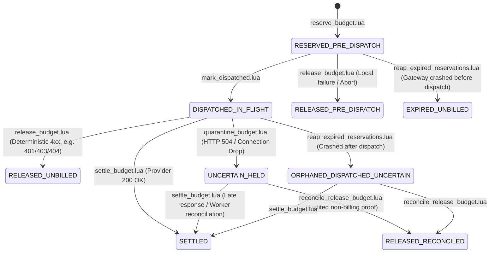

# RFC: Redis Budget Counter Contract & Real-Time Gateway Enforcement

- **Authors:** M1 (Vedant Rathod — AI Gateway) & M3 (Atharva Pawaskar — Worker / Asynchronous Pipeline)
- **Status:** Under Review — Revised Architectural Specification for Atharva Pawaskar's Formal Sign-Off
- **Target Task:** Task 3.2 Gate (Phase 3 Budget & Policy Enforcement)
- **Related Contracts:**
  - `contracts/db/budgets.v2.json`
  - `contracts/api/control-plane-budgets.v2.yaml`
  - `contracts/events/usage-event.v1.json`
  - `contracts/redis/keys.md`
  - `contracts/api/gateway-api.yaml`

---

## 1. Executive Summary & Distributed Financial Architecture

Kubefin enforces strict, sub-millisecond cost governance across multi-tenant AI workloads.
Under `contracts/db/budgets.v2.json` and `contracts/api/control-plane-budgets.v2.yaml`, currency-specific budget limits (`daily` or `monthly`, `hard` or `alert_only`) are configured in MongoDB.

### The Distributed Challenge: Synchronous Admission vs. Asynchronous Ingestion Lag
In the analytics pipeline, spend is calculated by the Worker consuming the Redis Stream `usage-events` and persisting enriched records into MongoDB `usage_events`.
Under production burst traffic, stream consumption and database indexing lag Gateway traffic by 50ms to several seconds.
If the Gateway relied purely on asynchronous Worker-computed MongoDB spend for admission control:
- High-concurrency bursts would pass admission checks simultaneously before any spend is reflected.
- Hard enterprise budgets would be breached by orders of magnitude before the first usage event is persisted.

### The Dual-System Architecture
To solve this without sacrificing low latency or financial auditability, Kubefin enforces a strict separation of concerns:
1. **System of Record (Historical / Financial Ledger):** **MongoDB `usage_events`** is the sole audited source of truth for invoicing, enterprise accounting, and historical rollups.
2. **Operational Admission Cache (Real-Time Synchronous):** **Redis** maintains sub-millisecond in-memory spend counters and active reservations to enforce hard limits *before* requests are dispatched to upstream LLM providers.
3. **Reconciliation Bridge:** A multi-dimensional, currency-aware reconciliation routine continuously audits Redis operational counters against MongoDB historical totals and heals drift without disrupting live traffic.

---

## 2. Core Architectural Protocols & Decision Resolution

### Protocol 1: Crash-Safe Lifecycle & Dispatch State Machine

#### The Flaw of Blind Expiry
A fundamental flaw in naive distributed reservation designs is releasing an expired reservation merely because a deadline passed.
If a Gateway process reserves budget, transmits request bytes to an upstream provider (OpenAI, Anthropic, or Google Gemini), and then crashes or loses network connectivity while awaiting the completion:
- The upstream provider backend may complete token generation and bill Kubefin for the request.
- If a background reaper blindly decrements `budget:reserved` and marks the reservation expired merely because a 120-second timer elapsed, the reservation is released while provider costs are actively incurred.
- This creates an unmetered financial leak where crashed or timed-out requests escape budget accounting.

#### Lifecycle State Machine
To guarantee crash safety, the reservation lifecycle strictly separates **pre-dispatch** from **post-dispatch** states:



#### Detailed State Definitions
1. **`RESERVED_PRE_DISPATCH`:**
   - Reservation recorded in Redis by `reserve_budget.lua`.
   - Invariant: Zero network bytes have been transmitted to the upstream provider.
   - If local validation, authentication, rate limiting, or circuit breaking fails, Gateway calls `release_budget.lua`, releasing `budget:reserved` immediately to state `RELEASED_PRE_DISPATCH`.
   - If the Gateway crashes before dispatch, the active reaper detects deadline expiry in `RESERVED_PRE_DISPATCH`.
     - If `current_reserved >= amount`: The reaper safely decrements `budget:reserved`, marks `EXPIRED_UNBILLED`, sets `reapedAt`, sets window retention TTL, and removes the entry from `budget:res_expiry`.
     - If `current_reserved < amount` (Invariant Underflow): The reaper **MUST NOT** silently skip or clamp to zero, and **MUST NOT** mutate `budget:reserved` or mark the record expired. It records `lastInvariantError = 'UNDERFLOW_ON_REAP'`, advances the score by 60s, increments `invariant_count`, and triggers Prometheus alert `gateway_budget_reaper_invariant_violations_total`.
2. **`DISPATCHED_IN_FLIGHT`:**
   - Transitioned atomically by `mark_dispatched.lua` immediately before Gateway invokes the upstream provider network call.
   - Invariant: Request bytes have been or are being transmitted. The upstream provider may execute inference.
   - If the Gateway crashes while in this state, the reaper **MUST NOT release the reservation**. The reaper transitions the record to `ORPHANED_DISPATCHED_UNCERTAIN` and retains the reservation in `budget:reserved`.
3. **`UNCERTAIN_HELD`:**
   - Upstream provider call returned HTTP 504 Gateway Timeout, connection reset, or client aborted during generation.
   - Invariant: Provider billing status is unknown. The reservation remains **HELD** in `budget:reserved`.
   - The 15-minute review window is a **Reconciliation Review Deadline**, NOT a key retention TTL.
4. **`ORPHANED_DISPATCHED_UNCERTAIN`:**
   - Gateway crashed after dispatching bytes upstream; detected by reaper.
   - The reservation remains **HELD** in `budget:reserved` pending automated billing reconciliation.
5. **`SETTLED`:**
   - Settled at actual integer micro-spend via `settle_budget.lua`.
   - Reservation decremented; cumulative `budget:spend` incremented.
6. **`RELEASED_PRE_DISPATCH` / `RELEASED_UNBILLED` / `RELEASED_RECONCILED`:**
   - Confirmed unbilled. Reservation decremented; zero spend added.

#### Audited Recovery for Missing or Corrupted Expiry Entries
- If an entry exists in `budget:res_expiry` whose corresponding `budget:req` record is missing, corrupted, or in an unknown state:
- The reaper **MUST NOT silently remove it (`ZREM`)**. Silently removing entries destroys evidence needed by reconciliation to identify drifted reservations.
- Instead, the reaper advances the entry's score in `budget:res_expiry` by 1 hour (`now + 3600000ms`), records `lastInvariantError = 'CORRUPTED_OR_MISSING_REQUEST_RECORD'`, increments `corrupted_count`, and emits alert `REAPER_CORRUPTED_ENTRY_DETECTED` to preserve the audit trail for reconciliation.

#### State Transition & Invariant Matrix

| Current State | Event / Trigger | Lua Script | Next State | `budget:reserved` Mutation | `budget:spend` Mutation | `budget:res_expiry` Action | Idempotent Replay Outcome |
|---|---|---|---|---|---|---|---|
| `None` | Admission Check | `reserve_budget.lua` | `RESERVED_PRE_DISPATCH` | `+reservation` | None | `ZADD deadline` | `ALLOWED` |
| `RESERVED_PRE_DISPATCH` | Client Retry (matching) | `reserve_budget.lua` | `RESERVED_PRE_DISPATCH` | None | None | None | `ALREADY_RESERVED` |
| `RESERVED_PRE_DISPATCH` | Pre-dispatch Abort / Error | `release_budget.lua` | `RELEASED_PRE_DISPATCH` | `-amount` (if valid) | None | `ZREM` | `RELEASED_PRE_DISPATCH` |
| `RESERVED_PRE_DISPATCH` | Upstream Dispatch Started | `mark_dispatched.lua` | `DISPATCHED_IN_FLIGHT` | None | None | `ZADD ext_deadline` | `DISPATCHED` |
| `RESERVED_PRE_DISPATCH` | Gateway Crashed (Reaper) | `reap_expired_reservations.lua` | `EXPIRED_UNBILLED` | `-amount` (if valid) | None | `ZREM` | `EXPIRED_UNBILLED` |
| `DISPATCHED_IN_FLIGHT` | Provider 200 OK | `settle_budget.lua` | `SETTLED` | `-amount` (if valid) | `+actual_spend` | `ZREM` | `SETTLED` |
| `DISPATCHED_IN_FLIGHT` | Deterministic Upstream 4xx | `release_budget.lua` | `RELEASED_UNBILLED` | `-amount` (if valid) | None | `ZREM` | `RELEASED_UNBILLED` |
| `DISPATCHED_IN_FLIGHT` | Provider 504 / Drop | `quarantine_budget.lua` | `UNCERTAIN_HELD` | None (Held) | None | `ZADD review_dl` | `QUARANTINED` |
| `DISPATCHED_IN_FLIGHT` | Gateway Crashed (Reaper) | `reap_expired_reservations.lua` | `ORPHANED_DISPATCHED_UNCERTAIN` | None (Held) | None | `ZADD review_dl` | `ORPHANED_DISPATCHED_UNCERTAIN` |
| `UNCERTAIN_HELD` | Late Provider Response | `settle_budget.lua` | `SETTLED` | `-amount` (if valid) | `+actual_spend` | `ZREM` | `SETTLED` |
| `UNCERTAIN_HELD` | Reconciled Unbilled | `reconcile_release_budget.lua` | `RELEASED_RECONCILED` | `-amount` (if valid) | None | `ZREM` | `RELEASED_RECONCILED` |
| `SETTLED` | Client Retry | `reserve_budget.lua` / `settle_budget.lua` | `SETTLED` | None | None | None | `ALREADY_SETTLED` |
| `RELEASED_*` | Client Retry | `reserve_budget.lua` / `release_budget.lua` | `RELEASED_*` | None | None | None | `ALREADY_RELEASED` |

#### Provider Retries and Event ID Isolation
- In `services/gateway/src/resilience/retry.ts`, transient provider errors (e.g. 503, 429) may trigger bounded upstream retries.
- **Critical Accounting Rule:** If an upstream attempt reached the provider wire and failed with an ambiguous error (e.g. timeout), the provider may bill for that attempt.
- Each upstream attempt that can independently incur charges MUST be assigned an attempt-specific `eventId` (UUIDv4) or sub-event identifier (`<logicalRequestId>:<attemptNumber>`).
- Separate physical provider dispatches must NEVER share an identical `eventId`.

---

### Protocol 2: Strict Numeric Bounds, Validation, & Anti-Clamping Arithmetic

#### Redis & Lua Runtime Realities
- Production Redis (versions 6.x and 7.x) embeds **Lua 5.1 / LuaJIT**.
- In Lua 5.1, numbers are IEEE-754 double-precision floating-point numbers with **53 bits of exact integer mantissa**.
- Lua 5.1 guarantees exact integer operations without rounding for integers up to:
  $$2^{53} - 1 = 9,007,199,254,740,991 \approx 9.007 \times 10^{15}$$

#### Explicit Safe Integer Bounds
To guarantee zero precision loss, zero numeric overflow, and absolute financial accuracy:
1. **Denomination:** All budget limits, reservations, and spend counters are measured in **integer micro-units** ($1 \text{ currency unit} = 1,000,000 \mu\text{units}$, e.g. $\$1.00 = 1,000,000 \mu\text{USD}$; $1 \mu\text{unit} = \$0.000001$).
2. **Explicit Counter Bounds:**
   - **Single Transaction / Reservation:** $1 \le \text{amount} \le 10^{12} \mu\text{units}$ ($\$1,000,000.00$).
   - **Configured Budget Limit:** $1 \le \text{limit} \le 10^{14} \mu\text{units}$ ($\$100,000,000.00$).
   - **Cumulative Spend & Reserved Sums:** $0 \le \text{counter} \le 4 \times 10^{14} \mu\text{units}$ ($\$400,000,000.00$).
   - **Intermediate Addition Ceiling:** Max possible addition is $\text{spend} + \text{reserved} + \text{reservation} \le 4 \times 10^{14} + 10^{12} \ll 9.007 \times 10^{15}$.
   - All operations are orders of magnitude below Lua's 53-bit limit.

#### Strict Input & Counter Validation
Every Lua script MUST validate all numeric parameters and all stored counters read from Redis:
- ASCII integer format assertion: `string.match(val, "^[0-9]+$")` (rejects negative signs, decimal points `.`, exponents `e`/`E`, and non-numeric garbage).
- Value range assertions: Check min and max bounds.
- If any input or stored counter fails validation, abort immediately: Return `{0, 0, 0, 'INVALID_NUMERIC_ARGUMENT'}` or `{0, 0, 0, 'CORRUPTED_STORED_COUNTER'}` before executing any mutation.

#### Anti-Clamping Invariant (No Silent Zero-Clamping)
- In accounting systems, clamping negative values to zero (e.g. `math.max(0, current_reserved - res_amount)`) is an anti-pattern that conceals accounting corruption, double releases, and race conditions.
- **Strict Rule:** If `current_reserved < res_amount`, the script **MUST NOT** clamp to zero.
- It MUST abort mutation, return `{0, current_reserved, 0, 'INVARIANT_RESERVED_UNDERFLOW'}`, and emit high-priority alert `BUDGET_INVARIANT_VIOLATION` to Prometheus and Control Plane.

#### No Mutation Before Validation
In Redis Lua, runtime script errors do NOT roll back writes executed earlier in the script.
All reference scripts strictly enforce **validation before mutation**:
1. Read all required keys and arguments.
2. Validate numeric formats, bounds, state transitions, and identity matches.
3. Check capacity or state prerequisites.
4. Execute mutations (`INCRBY`, `HMSET`, `ZADD`, `ZREM`, `EXPIRE`) only after all assertions pass.

#### Integer Ceiling Division
All rate conversions from tokens to micro-units use pure integer ceiling division:
$$\text{ceil\_micros}(N, D) = \left\lfloor \frac{N + D - 1}{D} \right\rfloor$$
- In TypeScript/JavaScript: `const ceilMicros = (num + 999_999n) / 1_000_000n;`
- In Lua: `local ceil_micros = math.floor((numerator + denominator - 1) / denominator)`

---

### Protocol 3: Request Identity, Multi-Dimensional Idempotency, & Retention

#### Complete Identity Tuple
To prevent collision or cross-tenant contamination, an `eventId` is bound to a complete 6-dimensional identity tuple:
$$\text{Identity Tuple} = (\text{tenantId}, \text{scopeType}, \text{scopeId}, \text{currency}, \text{period}, \text{amount})$$

#### Idempotent Reservation Protocol
When `reserve_budget.lua` receives a reservation request:
1. It queries `budget:req:{...}:<eventId>`.
2. If the record exists:
   - It reads stored fields: `state`, `amount`, `tenantId`, `scopeType`, `scopeId`, `currency`, `period`.
   - **Identity Validation:** If any stored field does not match incoming request parameters:
     Return `{0, 0, 0, 'CONFLICT_REQUEST_MISMATCH'}` (HTTP 409).
   - **State Validation:**
     - `RESERVED_PRE_DISPATCH` or `DISPATCHED_IN_FLIGHT`: Return `{1, (spend + reserved), limit, 'ALREADY_RESERVED'}` idempotently. Do NOT increment `budget:reserved`.
     - `SETTLED`: Return `{1, current_spend, limit, 'ALREADY_SETTLED'}`.
     - `RELEASED_*`: Return `{0, 0, 0, 'ALREADY_RELEASED'}`.
     - `UNCERTAIN_HELD` / `ORPHANED_DISPATCHED_UNCERTAIN`: Return `{0, 0, 0, 'UNCERTAIN_HELD'}`.
3. If the record does not exist:
   - Check budget limit and capacity.
   - Allocate reservation in `budget:reserved`.
   - Write full identity tuple to `budget:req:{...}:<eventId>` in state `RESERVED_PRE_DISPATCH`.
   - Add to `budget:res_expiry` with `deadline_timestamp_ms`.

#### Quarantine Review Deadline vs. Key Retention TTL
- In `quarantine_budget.lua`, an ambiguous timeout transitions the request to `UNCERTAIN_HELD`.
- **CRITICAL DISTINCTION:** The 15-minute window is a **Review Deadline** for operations/reconciliation, **NOT a key deletion TTL**.
- Storing `UNCERTAIN_HELD` records:
  - Key retention TTL on `budget:req:{...}:<eventId>` is set to the full window TTL (48 hours for daily, 35 days for monthly). The record is **never** passively deleted by Redis after 15 minutes.
  - The 15-minute deadline is scored in `budget:res_expiry`.
  - When 15 minutes elapses without settlement, the reaper alerts operations (`QUARANTINE_REVIEW_DEADLINE_EXCEEDED`).
  - The reservation amount remains safely held in `budget:reserved` until active reconciliation resolves it.

#### Retention of Settled and Released Records
- Settled and released records in `budget:req` must be retained in Redis for the duration of the budget window (48h daily / 35d monthly) so that late client retries receive deterministic idempotent responses rather than attempting new unmetered reservations.

---

### Protocol 4: Provider Billing Evidence & Safe Release Restrictions

#### Release Restrictions
Normal Gateway error handlers can invoke `release_budget.lua` **ONLY** when unambiguous proof exists that no provider charges were incurred:
1. **Pre-Dispatch Failures:** Local auth rejection (401), request validation error (400), tenant rate limit (429), circuit breaker open (503). State is `RESERVED_PRE_DISPATCH`. Release is 100% safe.
2. **Deterministic Upstream 4xx:** Upstream provider returns 401 (Invalid API Key), 403 (Permission Denied), 404 (Model Not Found), or 400 (Invalid syntax rejected before inference). State is `DISPATCHED_IN_FLIGHT`. Release is safe because the provider rejected the request before execution.
3. **Ambiguous Post-Dispatch Failures (Prohibited from Direct Release):**
   - HTTP 504 Gateway Timeout, connection reset, socket hangup, or client disconnect during streaming.
   - Calling `release_budget.lua` on an ambiguous post-dispatch request is **strictly rejected** with `CANNOT_RELEASE_POTENTIALLY_BILLED_REQUEST`.
   - Gateway must call `quarantine_budget.lua` (`UNCERTAIN_HELD`).

#### Overrun Handling Policy
A reservation is an upper-bound estimate. If actual tokens generated or model reasoning tokens result in `actual_spend_micros > reservation_micros`, or push cumulative spend beyond `limit`:
1. **Provider Charges Cannot Be Undone:** The upstream provider executed inference and will invoice for it. Actual costs must be recorded.
2. **Accounting Adjustment:**
   - `budget:reserved` decrements by `reservation_micros`.
   - `budget:spend` increments by TRUE `actual_spend_micros`.
3. **Enforcement:** The current request returns HTTP 200 OK with `X-Budget-Remaining: 0`. The budget is now officially breached (`spend >= limit`). All subsequent requests fail admission control with HTTP 402 `BUDGET_EXCEEDED`.
4. **Alerting:** Emit Prometheus counter `gateway_budget_overrun_total` and alert Control Plane.

---

### Protocol 5: Multi-Dimensional Currency-Aware Reconciliation & Drift Repair

#### Multi-Dimensional Isolation
Reconciliation queries and updates MUST strictly partition by all 5 budget dimensions:
$$\text{Dimension Key} = (\text{tenantId}, \text{scopeType}, \text{scopeId}, \text{currency}, \text{UTC period window})$$
Amounts in USD, INR, or EUR are never combined or compared.

#### Alignment with Worker Decimal128
- In MongoDB, costs are stored as `Decimal128` with 12 decimal places (`costAmount`) in the pricing catalog currency (`contracts/db/pricing-catalog.v1.json`).
- Conversion to integer micro-units:
  $$\text{mongo\_micros} = \left\lceil \text{costAmount} \times 1,000,000 \right\rceil$$

#### Safe Drift Repair (No Blind Overwrites)
At reconciliation time, live traffic is continuously settling in Redis.
If reconciliation naively executes `SET budget:spend = mongo_sum`, it erases all legitimate spend settled by the Gateway during Worker ingestion lag.
**The Safe Drift Adjustment Protocol:**
1. Select a historical cutoff timestamp: $T_{\text{cutoff}} = \text{now} - 5 \text{ minutes}$.
2. Query MongoDB for sum of settled events where $\text{occurredAt} < T_{\text{cutoff}}$ for the specific dimension key.
3. Compare against Redis historical spend recorded for events prior to $T_{\text{cutoff}}$.
4. Calculate audited drift:
   $$\text{drift} = \text{mongo\_audited\_micros} - \text{redis\_historical\_micros}$$
5. If $\text{drift} > 0$: Apply the delta atomically using native increment:
   `INCRBY budget:spend:{...}:<window> drift`
6. Never execute an unconditional `SET` on active cumulative spend counters.

---

### Protocol 6: Default Fail-Closed & Authorized Unconstrained Bypass

#### Strict Default Fail-Closed
- In enterprise cost governance, missing configuration MUST default to strict denial.
- If `budget:limit:{...}` does not exist in Redis, the Gateway and Lua scripts MUST fail closed with HTTP 402 `Payment Required` and error code `NO_BUDGET_FOR_CURRENCY`.
- No request argument (`ARGV`) can disable this fail-closed default.

#### Authorized Unconstrained Bypass (Configuration via `budget:meta` Hash)
- Unconstrained spend is permitted ONLY if an authorized entitlement exists in the budget metadata hash:
  1. The Control Plane configures an explicit flag in `budget:meta:{budget:<tenantId>:<scopeType>:<scopeId>:<currency>:<period>}`: `unconstrained: "1"`, written by an authorized administrative principal after authentication and authorization.
  2. Because `budget:meta` shares the exact same hash tag `{budget:...}`, it is accessed in the same Redis Cluster slot without `CROSSSLOT` errors.
  3. **No standalone `budget:unconstrained:{tenantId}` key exists.** The metadata hash is the single source of truth for bypass configuration.
- Gateway clients **cannot** request or override bypass using request parameters, headers, or any client-controlled input.
- The `unconstrained` field is configuration, not proof of authorization by itself. The Control Plane must authenticate and authorize the administrator before synchronizing this flag into Redis.
- Field behavior:
  - **Absent or `"0"`**: Normal budget enforcement applies.
  - **`"1"`**: Unconstrained mode — budget limit check is skipped, admission always allowed for that budget scope (all dimensions: tenant, scopeType, scopeId, currency, period).
  - **Malformed values** (anything other than `"0"` or `"1"`): Treated as `"0"` (normal enforcement) with audit log warning **and** Prometheus alert `gateway_budget_meta_malformed_total` emitted.
- When unconstrained mode is active: all budget dimensions for that scope are bypassed; audit event `budget_unconstrained_admission_total` is emitted on each admission; response header `X-Budget-Mode: unconstrained` is included.
- This is the only bypass mechanism. No request-level bypass flags exist.

---

### Protocol 6.1: Reservation Counter Safety — No Expiry on Active/Uncertain Reservations

#### `budget:reserved` — Non-Expiring While Reservations Exist
- The `budget:reserved:{budget:...}` counter **MUST NOT** carry a TTL while any request record in `budget:req` for that budget scope is in a non-terminal state (`RESERVED_PRE_DISPATCH`, `DISPATCHED_IN_FLIGHT`, `UNCERTAIN_HELD`, `ORPHANED_DISPATCHED_UNCERTAIN`).
- Reference scripts **MUST NOT** call `EXPIRE` on `budget:reserved` (KEYS[3] in `reserve_budget.lua`, KEYS[2] in `settle_budget.lua`, KEYS[1] in `release_budget.lua`). All `EXPIRE` calls on the reservation counter are removed.
- If Redis restarts or the key is lost (e.g., eviction, failover), the counter **MUST NOT** be silently reset to zero. Recovery procedure:
  1. On Gateway startup or budget-scope reinitialization, reconstruct `budget:reserved` by scanning `budget:req` hashes for the budget scope and summing `amount` for all records whose state is `RESERVED_PRE_DISPATCH`, `DISPATCHED_IN_FLIGHT`, `UNCERTAIN_HELD`, or `ORPHANED_DISPATCHED_UNCERTAIN`.
  2. If `budget:res_expiry` sorted set exists, cross-verify: any `eventId` present in the sorted set but missing from `budget:req` is a **corrupted/missing request record** — do not assume zero cost. Record `lastInvariantError = 'MISSING_REQUEST_RECORD_ON_REBUILD'`, emit alert `gateway_budget_rebuild_missing_records_total`, and retain the sorted-set entry for reconciliation.
  3. If neither `budget:req` nor `budget:res_expiry` exists for the scope, initialize `budget:reserved = 0`.
  4. Never trust a missing counter as proof that no reservations exist.

#### `budget:spend` — Window-Partitioned Retention with Reconciliation Watermark
- `budget:spend:{budget:...}:<window>` is partitioned by UTC period window (`YYYY-MM-DD` for daily, `YYYY-MM` for monthly).
- **Retention rule:** The key **MUST NOT** expire before the budget window closes **plus** a reconciliation grace period of 24 hours (daily) / 7 days (monthly).
  - Daily window TTL: 48 hours (window) + 24 hours (grace) = **72 hours** minimum.
  - Monthly window TTL: 35 days (window) + 7 days (grace) = **42 days** minimum.
- The grace period ensures the hourly reconciliation job can read historical spend from Redis for windows that have technically closed but may still have in-flight Gateway settlements or Worker ingestion lag.
- After the grace period, the reconciliation job marks the window as `RECONCILED` in a control key `budget:recon:{budget:...}:<window> = "COMPLETE"`. Only then may the spend key be allowed to expire.
- If Redis loses the spend key before the grace period ends, rebuild from MongoDB: sum `costAmount` (ceiling to micro-units) for all `usage_events` with `occurredAt` in that window and matching the 5 budget dimensions. Write the rebuilt value to Redis with the full remaining TTL.

#### `budget:req` — State-Gated Retention (Review Deadline ≠ Deletion TTL)
- `budget:req:{budget:...}:<eventId>` records **MUST NOT** expire while the request state is non-terminal:
  - `RESERVED_PRE_DISPATCH`, `DISPATCHED_IN_FLIGHT`, `UNCERTAIN_HELD`, `ORPHANED_DISPATCHED_UNCERTAIN` — **No TTL**. The record persists until the reservation is explicitly settled or released via Lua script.
  - `SETTLED`, `RELEASED_PRE_DISPATCH`, `RELEASED_UNBILLED`, `RELEASED_RECONCILED`, `EXPIRED_UNBILLED` — **Window-based retention**: TTL = remaining window duration (48h daily / 35d monthly) so late client retries receive deterministic idempotent responses (`ALREADY_SETTLED`, `ALREADY_RELEASED`).
- The 15-minute quarantine review deadline (`UNCERTAIN_HELD` state) is an **operational review deadline only**, scored in `budget:res_expiry`. It **does not** trigger key deletion.
- When a record transitions to a terminal state (`SETTLED` or any `RELEASED_*`), the Lua script sets `EXPIRE` to the window retention TTL (not the review deadline).
- If Redis loses a terminal-state record, idempotency is preserved because the Worker has already persisted the event to MongoDB with the same `eventId` (unique index). A late client retry will be handled by the Worker's duplicate detection, not by Redis.

---

### Protocol 6.2: Reconciliation — Design Limitations & Open Decisions

**Status: This reconciliation protocol is NOT yet safe for implementation. Task 3.2 remains blocked for M3 review on the items below.**

The current reconciliation design has fundamental safety gaps that cannot be resolved without additional shared-contract decisions. The following issues are documented honestly rather than papered over with an unsafe algorithm.

#### Identified Safety Gaps

1. **Double-Count Risk:** The proposed comparison sums `budget:spend` (which already includes settled events) **plus** `settledCost` from request records. Any event already reflected in `budget:spend` will be double-counted in the Redis historical sum.

2. **Incomplete Event Identity in Redis:** The `budget:spend` counter is an opaque aggregate. It does not carry `eventId` identity. Reconciliation cannot distinguish "event already in spend" from "event not yet in spend" without a durable event-level index in Redis — which does not exist in this contract.

3. **Five-Minute Cutoff Is Not Sufficient:** The `T_cutoff = now - 5 min` heuristic does not guarantee all in-flight settlements have landed. A slow provider response, circuit-breaker retry, or Worker ingestion lag can exceed 5 minutes. There is no proven bound.

4. **Positive-Only Delta Repair Is Not Reconciliation:** Accepting only positive drift (`mongo > redis`) and alerting on negative drift (`redis > mongo`) leaves the system in an unreconciled state when Redis overcounts. This is a detection mechanism, not a repair protocol.

5. **No Idempotent Replay Guarantee:** The `runId` monotonicity check does not prevent duplicate delta application if:
   - MongoDB retries insert the same event twice (Worker bug or network retry)
   - The reconciliation job crashes after `INCRBY` but before persisting `runId`
   - Two reconciliation instances acquire the lock sequentially due to clock skew

#### Required Design Decisions (Blocked for M3 Review)

Before Task 3.2 can proceed, the team must agree on **one** of the following approaches:

**Option A: Event-Level Redis Index (Recommended for Auditability)**
- Add a per-event Redis index: `budget:event:{budget:...}:<eventId>` → `settledCost` (or `0` if released).
- Reconciliation reads MongoDB event IDs for the window, fetches each from Redis, and computes drift per-event.
- `INCRBY spend` only for events missing from Redis or with mismatched cost.
- Cost: Additional Redis key per event (~50–100 bytes). Fits in hash slot.

**Option B: Window-Versioned Spend Counter with Append-Only Log**
- Replace `budget:spend` with `budget:spend_log:{budget:...}:<window>` (Redis Stream or List of `{eventId, cost}`).
- Reconciliation replays the log vs MongoDB, rebuilds the aggregate atomically, and atomically swaps the active counter.
- Cost: Log grows with event count; requires periodic compaction.

**Option C: Reconciliation as Detection-Only, Manual Repair**
- Reconciliation job **only computes and alerts drift**. Never mutates `budget:spend` automatically.
- Operations runs a controlled, audited repair procedure (documented runbook) when drift exceeds threshold.
- Simplest contract; pushes complexity to operational process.

#### Current Safe Fallback (If No Decision Is Reached)

Until M3 approves a reconciliation design:
- **Do not implement automated reconciliation.**
- `budget:spend` is written once per settlement via `INCRBY` and never mutated by a background job.
- Drift detection runs as a read-only audit job (emits Prometheus metrics only).
- Manual repair procedure is documented in a separate runbook (not in this RFC).
- Task 3.2 Gateway implementation **can proceed with admission control and settlement** but **must not include a reconciliation writer**.

#### Recovery Procedure for Missing Spend Key (Only for Option A or B)
- If the chosen design includes a rebuildable spend key and the key is missing at startup:
  1. Acquire distributed lock `budget:recon:lock:{budget:...}`.
  2. Recompute from MongoDB for the active window only.
  3. Write rebuilt value with TTL = remaining grace period.
  4. Mark `budget:recon:{budget:...}:<window>.rebuiltAt = now`, `source = "MONGODB_REBUILD"`.
  5. Release lock and emit alert `gateway_budget_spend_rebuilt_total{window="..."}`.
  6. Do NOT run ordinary reconciliation in the same cycle.

#### Metrics & Alerts (Proposed — Not Implemented)
- `gateway_budget_reconciliation_drift_micros{window, direction="positive|negative"}` — Gauge, drift magnitude.
- `gateway_budget_reconciliation_skipped_total{window, reason}` — Counter, why reconciliation did not run (lock held, no decision, etc.).
- `gateway_budget_spend_rebuilt_total{window}` — Counter, spend key rebuilt from MongoDB.

---

### Protocol 7: Crash-Safe Gateway-to-Worker Event Delivery & Dual-Write Recovery

| Failure Scenario | State in Redis | State in Stream / Mongo | Recovery Mechanism |
|---|---|---|---|
| **1. Gateway crashes before dispatch** | `RESERVED_PRE_DISPATCH` | No event | Active Reaper detects deadline expiry; confirms pre-dispatch; safely decrements `budget:reserved`; marks `EXPIRED_UNBILLED`. |
| **2. Gateway crashes after dispatch** | `DISPATCHED_IN_FLIGHT` | No event | Active Reaper detects deadline expiry; identifies post-dispatch; transitions to `ORPHANED_DISPATCHED_UNCERTAIN`; retains reservation in `budget:reserved`; alerts reconciliation. |
| **3. Settlement succeeds, stream `XADD` fails** | `SETTLED` | No event | Gateway catches `XADD` failure; spools event to local disk fallback; background drainer retries `XADD` with identical UUID `eventId`. |
| **4. Stream published, Gateway crashes before HTTP 200** | `SETTLED` | Event published | Worker persists to MongoDB. Client retries request with same `x-request-id`; Gateway recognizes `eventId` as `ALREADY_SETTLED` and returns cached completion. |
| **5. Worker persists to MongoDB, stream `XACK` fails** | `SETTLED` | Pending in PEL | Worker reclaims pending entry (`XAUTOCLAIM`). MongoDB unique index `_id: eventId` returns duplicate key error; Worker recognizes duplicate (`'duplicate'`) and sends `XACK`. Zero double-counting. |
| **6. Provider times out after request sent** | `UNCERTAIN_HELD` | No event yet | Held in quarantine in `budget:reserved` pending automated billing reconciliation. |

---

## 3. Reference Lua Script Specifications

All keys share the hash tag `{budget:<tenantId>:<scopeType>:<scopeId>:<currency>:<period>}` ensuring 100% Redis Cluster slot co-location.

### Script 1: `reserve_budget.lua`
```lua
-- KEYS[1]: budget:limit:{budget:...}
-- KEYS[2]: budget:spend:{budget:...}:<window>
-- KEYS[3]: budget:reserved:{budget:...}
-- KEYS[4]: budget:req:{budget:...}:<eventId>
-- KEYS[5]: budget:res_expiry:{budget:...}
-- KEYS[6]: budget:meta:{budget:...}
-- ARGV[1]: reservation_micros (int string, 1 to 10^12)
-- ARGV[2]: req_ttl_seconds (int string, e.g. 172800) -- terminal-state retention only
-- ARGV[3]: window_ttl_seconds (int string, e.g. 259200) -- spend TTL: 72h daily / 42d monthly incl. grace
-- ARGV[4]: current_epoch_ms (int string)
-- ARGV[5]: deadline_epoch_ms (int string)
-- ARGV[6]: event_id (string UUID)
-- ARGV[7]: tenant_id (string)
-- ARGV[8]: scope_type (string)
-- ARGV[9]: scope_id (string)
-- ARGV[10]: currency (string)
-- ARGV[11]: period (string)

-- 1. Numeric Validation of Inputs
if not string.match(ARGV[1], "^[0-9]+$") then
    return {0, 0, 0, 'INVALID_NUMERIC_ARGUMENT'}
end
local reservation = tonumber(ARGV[1])
if reservation < 1 or reservation > 1000000000000 then -- Max 10^12 micros ($1M)
    return {0, 0, 0, 'RESERVATION_OUT_OF_BOUNDS'}
end
-- Validate timestamps and TTLs
if not string.match(ARGV[4] or '', "^[0-9]+$") or not string.match(ARGV[5] or '', "^[0-9]+$") then
    return {0, 0, 0, 'INVALID_NUMERIC_ARGUMENT'}
end
local current_epoch = tonumber(ARGV[4])
local deadline_epoch = tonumber(ARGV[5])
if deadline_epoch <= current_epoch then
    return {0, 0, 0, 'INVALID_DEADLINE'}
end
if not string.match(ARGV[3] or '', "^[0-9]+$") then
    return {0, 0, 0, 'INVALID_NUMERIC_ARGUMENT'}
end
local window_ttl = tonumber(ARGV[3])
if window_ttl < 1 or window_ttl > 3628800 then -- max 42 days
    return {0, 0, 0, 'INVALID_TTL'}
end

-- 2. Idempotency Check & Identity Verification
local existing_state = redis.call('HGET', KEYS[4], 'state')
if existing_state then
    local stored = redis.call('HMGET', KEYS[4], 'amount', 'tenantId', 'scopeType', 'scopeId', 'currency', 'period')
    local stored_amount_str = stored[1]
    if not stored_amount_str or not string.match(stored_amount_str, "^[0-9]+$") then
        return {0, 0, 0, 'CORRUPTED_REQUEST_RECORD'}
    end
    local stored_amount = tonumber(stored_amount_str)
    local stored_tenant = stored[2]
    local stored_stype = stored[3]
    local stored_sid = stored[4]
    local stored_curr = stored[5]
    local stored_period = stored[6]

    -- Verify complete identity tuple
    if stored_tenant ~= ARGV[7] or stored_stype ~= ARGV[8] or stored_sid ~= ARGV[9] or
       stored_curr ~= ARGV[10] or stored_period ~= ARGV[11] or stored_amount ~= reservation then
        return {0, 0, 0, 'CONFLICT_REQUEST_MISMATCH'}
    end

    local current_spend = tonumber(redis.call('GET', KEYS[2]) or '0')
    local current_reserved = tonumber(redis.call('GET', KEYS[3]) or '0')
    local limit = tonumber(redis.call('GET', KEYS[1]) or '0')

    if existing_state == 'RESERVED_PRE_DISPATCH' or existing_state == 'DISPATCHED_IN_FLIGHT' then
        return {1, (current_spend + current_reserved), limit, 'ALREADY_RESERVED'}
    elseif existing_state == 'SETTLED' then
        return {1, current_spend, limit, 'ALREADY_SETTLED'}
    elseif string.find(existing_state, '^RELEASED') or existing_state == 'EXPIRED_UNBILLED' then
        return {0, 0, 0, 'ALREADY_RELEASED'}
    elseif existing_state == 'UNCERTAIN_HELD' or existing_state == 'ORPHANED_DISPATCHED_UNCERTAIN' then
        return {0, 0, 0, 'UNCERTAIN_HELD'}
    end
end

-- 3. Check Unconstrained Bypass in Metadata
local meta_unconstrained = redis.call('HGET', KEYS[6], 'unconstrained')
if meta_unconstrained == '1' then
    -- Bypass still requires identity checks; return spend=0, reserved=0 as signal
    return {1, 0, 0, 'UNCONSTRAINED'}
elseif meta_unconstrained and meta_unconstrained ~= '0' then
    -- Malformed value: fail closed and alert
    return {0, 0, 0, 'INVALID_UNCONSTRAINED_VALUE'}
end

-- 4. Budget Limit Existence Check (Strict Fail-Closed)
local limit_str = redis.call('GET', KEYS[1])
if not limit_str or not string.match(limit_str, "^[0-9]+$") then
    return {0, 0, 0, 'NO_BUDGET_FOR_CURRENCY'}
end
local limit = tonumber(limit_str)
if limit < 1 or limit > 100000000000000 then -- Max 10^14 micros ($100M)
    return {0, 0, 0, 'LIMIT_OUT_OF_BOUNDS'}
end

-- 5. Validate Stored Counters
local spend_str = redis.call('GET', KEYS[2]) or '0'
local reserved_str = redis.call('GET', KEYS[3]) or '0'
if not string.match(spend_str, "^[0-9]+$") or not string.match(reserved_str, "^[0-9]+$") then
    return {0, 0, 0, 'CORRUPTED_STORED_COUNTER'}
end
local current_spend = tonumber(spend_str)
local current_reserved = tonumber(reserved_str)

-- 6. Capacity Admission Check with overflow-safe sum
local meta_enforcement = redis.call('HGET', KEYS[6], 'enforcement')
if meta_enforcement ~= 'alert_only' then
    -- Check bounds before addition to prevent overflow
    if current_spend > 400000000000000 or current_reserved > 400000000000000 then
        return {0, 0, 0, 'COUNTER_OUT_OF_BOUNDS'}
    end
    local projected = current_spend + current_reserved + reservation
    if projected > limit then
        return {0, (current_spend + current_reserved), limit, 'BUDGET_EXCEEDED'}
    end
end

-- 7. Atomic State Mutation (Only after all validations pass)
local new_reserved = redis.call('INCRBY', KEYS[3], reservation)
redis.call('HMSET', KEYS[4],
    'amount', ARGV[1],
    'state', 'RESERVED_PRE_DISPATCH',
    'createdAt', ARGV[4],
    'deadlineAt', ARGV[5],
    'tenantId', ARGV[7],
    'scopeType', ARGV[8],
    'scopeId', ARGV[9],
    'currency', ARGV[10],
    'period', ARGV[11]
)
-- budget:req TTL for non-terminal states: NO EXPIRE while reservation is active.
-- Terminal states (SETTLED, RELEASED_*) will set EXPIRE on transition.
-- budget:reserved MUST NOT have TTL while any non-terminal request exists.
-- budget:spend TTL = window_ttl_seconds (72h daily / 42d monthly including grace)
redis.call('EXPIRE', KEYS[2], window_ttl)

-- Register in sorted set for active reaper tracking
redis.call('ZADD', KEYS[5], deadline_epoch, ARGV[6])

return {1, (current_spend + new_reserved), limit, 'ALLOWED'}
```

### Script 2: `mark_dispatched.lua`
```lua
-- KEYS[1]: budget:req:{budget:...}:<eventId>
-- KEYS[2]: budget:res_expiry:{budget:...}
-- ARGV[1]: current_epoch_ms (int string)
-- ARGV[2]: extended_deadline_epoch_ms (int string)
-- ARGV[3]: event_id (string UUID)

-- Validate timestamps
if not string.match(ARGV[1] or '', "^[0-9]+$") or not string.match(ARGV[2] or '', "^[0-9]+$") then
    return {0, 'INVALID_NUMERIC_ARGUMENT'}
end
local current_epoch = tonumber(ARGV[1])
local extended_deadline = tonumber(ARGV[2])
if extended_deadline <= current_epoch then
    return {0, 'INVALID_DEADLINE'}
end

local state = redis.call('HGET', KEYS[1], 'state')
if not state then
    return {0, 'NO_ACTIVE_RESERVATION'}
end

-- Validate required fields exist on the request record before transition
local amount_str = redis.call('HGET', KEYS[1], 'amount')
if not amount_str or not string.match(amount_str, "^[0-9]+$") then
    return {0, 'CORRUPTED_REQUEST_RECORD'}
end

if state == 'RESERVED_PRE_DISPATCH' then
    redis.call('HMSET', KEYS[1],
        'state', 'DISPATCHED_IN_FLIGHT',
        'dispatchedAt', ARGV[1],
        'deadlineAt', ARGV[2]
    )
    redis.call('ZADD', KEYS[2], extended_deadline, ARGV[3])
    return {1, 'DISPATCHED'}
elseif state == 'DISPATCHED_IN_FLIGHT' then
    return {1, 'ALREADY_DISPATCHED'}
else
    return {0, 'INVALID_TRANSITION_FROM_' .. state}
end
```

### Script 3: `settle_budget.lua`
```lua
-- KEYS[1]: budget:spend:{budget:...}:<window>
-- KEYS[2]: budget:reserved:{budget:...}
-- KEYS[3]: budget:req:{budget:...}:<eventId>
-- KEYS[4]: budget:res_expiry:{budget:...}
-- ARGV[1]: actual_spend_micros (int string, 0 to 10^12)
-- ARGV[2]: window_ttl_seconds (int string, 72h daily / 42d monthly incl. grace)
-- ARGV[3]: retention_ttl_seconds (int string, 48h daily / 35d monthly)
-- ARGV[4]: current_epoch_ms (int string)
-- ARGV[5]: event_id (string UUID)

-- 1. Input Validation
if not string.match(ARGV[1], "^[0-9]+$") then
    return {0, 0, 0, 'INVALID_NUMERIC_ARGUMENT'}
end
local actual_spend = tonumber(ARGV[1])
if actual_spend > 1000000000000 then -- Max 10^12 micros
    return {0, 0, 0, 'ACTUAL_SPEND_OUT_OF_BOUNDS'}
end
if not string.match(ARGV[2] or '', "^[0-9]+$") or not string.match(ARGV[3] or '', "^[0-9]+$") then
    return {0, 0, 0, 'INVALID_NUMERIC_ARGUMENT'}
end
local window_ttl = tonumber(ARGV[2])
local retention_ttl = tonumber(ARGV[3])
if window_ttl < 1 or window_ttl > 3628800 then -- max 42 days
    return {0, 0, 0, 'INVALID_TTL'}
end
if retention_ttl < 1 or retention_ttl > 3024000 then -- max 35 days
    return {0, 0, 0, 'INVALID_TTL'}
end
if not string.match(ARGV[4] or '', "^[0-9]+$") then
    return {0, 0, 0, 'INVALID_NUMERIC_ARGUMENT'}
end

-- 2. State & Idempotency Check
local req_data = redis.call('HMGET', KEYS[3], 'state', 'amount', 'settledCost')
local state = req_data[1]
local res_amount_str = req_data[2]
local stored_settled = req_data[3]

if not state then
    return {0, 0, 0, 'NO_ACTIVE_RESERVATION'}
end

-- Validate stored reservation amount before using it
if not res_amount_str or not string.match(res_amount_str, "^[0-9]+$") then
    return {0, 0, 0, 'CORRUPTED_REQUEST_RECORD'}
end
local res_amount = tonumber(res_amount_str)

local spend_str = redis.call('GET', KEYS[1]) or '0'
local reserved_str = redis.call('GET', KEYS[2]) or '0'
if not string.match(spend_str, "^[0-9]+$") or not string.match(reserved_str, "^[0-9]+$") then
    return {0, 0, 0, 'CORRUPTED_STORED_COUNTER'}
end
local current_spend = tonumber(spend_str)
local current_reserved = tonumber(reserved_str)

if state == 'SETTLED' then
    if stored_settled == ARGV[1] then
        return {1, current_spend, current_reserved, 'ALREADY_SETTLED'}
    else
        return {0, 0, 0, 'CONFLICT_SETTLEMENT_MISMATCH'}
    end
end

if string.find(state, '^RELEASED') or state == 'EXPIRED_UNBILLED' then
    return {0, 0, 0, 'ALREADY_RELEASED'}
end

-- Must be in an active in-flight or held state
if state ~= 'RESERVED_PRE_DISPATCH' and state ~= 'DISPATCHED_IN_FLIGHT' and
   state ~= 'UNCERTAIN_HELD' and state ~= 'ORPHANED_DISPATCHED_UNCERTAIN' then
    return {0, 0, 0, 'INVALID_RESERVATION_STATE'}
end

-- 3. Invariant Underflow Check (Anti-Clamping)
if current_reserved < res_amount then
    return {0, current_reserved, 0, 'INVARIANT_RESERVED_UNDERFLOW'}
end

-- Validate result bounds before mutation
local new_reserved = current_reserved - res_amount
if new_reserved > 400000000000000 then
    return {0, 0, 0, 'COUNTER_OUT_OF_BOUNDS'}
end

local new_spend = current_spend + actual_spend
if new_spend > 400000000000000 then
    return {0, 0, 0, 'COUNTER_OUT_OF_BOUNDS'}
end

-- 4. Atomic Mutations (validation complete, now mutate)
redis.call('SET', KEYS[2], new_reserved)

-- Increment actual cumulative spend (overrun preserved)
redis.call('INCRBY', KEYS[1], actual_spend)
-- budget:spend TTL = window_ttl_seconds (72h daily / 42d monthly including grace)
redis.call('EXPIRE', KEYS[1], window_ttl)

-- Update request state and retain record with window retention TTL (not review deadline)
redis.call('HMSET', KEYS[3],
    'state', 'SETTLED',
    'settledCost', ARGV[1],
    'settledAt', ARGV[4]
)
-- Terminal state: set EXPIRE to window retention TTL (ARGV[3] = 48h daily / 35d monthly)
redis.call('EXPIRE', KEYS[3], retention_ttl)
redis.call('ZREM', KEYS[4], ARGV[5])

return {1, new_spend, new_reserved, 'SETTLED'}
```

### Script 4: `release_budget.lua`
```lua
-- KEYS[1]: budget:reserved:{budget:...}
-- KEYS[2]: budget:req:{budget:...}:<eventId>
-- KEYS[3]: budget:res_expiry:{budget:...}
-- ARGV[1]: retention_ttl_seconds (int string, 48h daily / 35d monthly)
-- ARGV[2]: current_epoch_ms (int string)
-- ARGV[3]: release_reason (string, must be 'UPSTREAM_DETERMINISTIC_4XX' for post-dispatch)
-- ARGV[4]: event_id (string UUID)

-- Validate inputs
if not string.match(ARGV[1] or '', "^[0-9]+$") or not string.match(ARGV[2] or '', "^[0-9]+$") then
    return {0, 0, 'INVALID_NUMERIC_ARGUMENT'}
end
local retention_ttl = tonumber(ARGV[1])
if retention_ttl < 1 or retention_ttl > 3024000 then -- max 35 days
    return {0, 0, 'INVALID_TTL'}
end

local req_data = redis.call('HMGET', KEYS[2], 'state', 'amount')
local state = req_data[1]
local res_amount_str = req_data[2]

if not state then
    return {0, 0, 'NO_ACTIVE_RESERVATION'}
end

-- Validate stored amount
if not res_amount_str or not string.match(res_amount_str, "^[0-9]+$") then
    return {0, 0, 'CORRUPTED_REQUEST_RECORD'}
end
local res_amount = tonumber(res_amount_str)

local reserved_str = redis.call('GET', KEYS[1]) or '0'
if not string.match(reserved_str, "^[0-9]+$") then
    return {0, 0, 'CORRUPTED_STORED_COUNTER'}
end
local current_reserved = tonumber(reserved_str)

if string.find(state, '^RELEASED') or state == 'EXPIRED_UNBILLED' then
    return {1, current_reserved, 'ALREADY_RELEASED'}
end

if state == 'SETTLED' then
    return {0, current_reserved, 'ALREADY_SETTLED'}
end

-- Normal release is permitted ONLY if confirmed not dispatched, or deterministic upstream rejection
local allowed_reason = (ARGV[3] == 'UPSTREAM_DETERMINISTIC_4XX')
if state ~= 'RESERVED_PRE_DISPATCH' and not allowed_reason then
    return {0, current_reserved, 'CANNOT_RELEASE_POTENTIALLY_BILLED_REQUEST'}
end
if state == 'UNCERTAIN_HELD' or state == 'ORPHANED_DISPATCHED_UNCERTAIN' then
    -- Explicitly reject release for uncertain states even with the reason
    return {0, current_reserved, 'CANNOT_RELEASE_POTENTIALLY_BILLED_REQUEST'}
end

-- Invariant Underflow Check (Anti-Clamping)
if current_reserved < res_amount then
    return {0, current_reserved, 'INVARIANT_RESERVED_UNDERFLOW'}
end

-- Validate result bounds
local new_reserved = current_reserved - res_amount
if new_reserved > 400000000000000 then
    return {0, 0, 'COUNTER_OUT_OF_BOUNDS'}
end

-- Atomic Mutations
redis.call('SET', KEYS[1], new_reserved)

local target_state = (state == 'RESERVED_PRE_DISPATCH') and 'RELEASED_PRE_DISPATCH' or 'RELEASED_UNBILLED'

redis.call('HMSET', KEYS[2],
    'state', target_state,
    'releasedAt', ARGV[2],
    'releaseReason', ARGV[3]
)
-- Terminal state: set EXPIRE to window retention TTL (ARGV[1] = 48h daily / 35d monthly)
redis.call('EXPIRE', KEYS[2], retention_ttl)
redis.call('ZREM', KEYS[3], ARGV[4])

return {1, new_reserved, target_state}
```

### Script 5: `quarantine_budget.lua`
```lua
-- KEYS[1]: budget:req:{budget:...}:<eventId>
-- KEYS[2]: budget:res_expiry:{budget:...}
-- ARGV[1]: review_deadline_ms (int string)
-- ARGV[2]: current_epoch_ms (int string)
-- ARGV[3]: quarantine_reason (string)
-- ARGV[4]: event_id (string UUID)

-- Validate timestamps
if not string.match(ARGV[1] or '', "^[0-9]+$") or not string.match(ARGV[2] or '', "^[0-9]+$") then
    return {0, 'INVALID_NUMERIC_ARGUMENT'}
end
local review_deadline = tonumber(ARGV[1])
local current_epoch = tonumber(ARGV[2])
if review_deadline <= current_epoch then
    return {0, 'INVALID_DEADLINE'}
end

local state = redis.call('HGET', KEYS[1], 'state')
if not state then
    return {0, 'NO_ACTIVE_RESERVATION'}
end

-- Validate required fields exist
local amount_str = redis.call('HGET', KEYS[1], 'amount')
if not amount_str or not string.match(amount_str, "^[0-9]+$") then
    return {0, 'CORRUPTED_REQUEST_RECORD'}
end

-- Only quarantine post-dispatch requests. Pre-dispatch requests must use release_budget.lua.
if state == 'DISPATCHED_IN_FLIGHT' then
    redis.call('HMSET', KEYS[1],
        'state', 'UNCERTAIN_HELD',
        'quarantinedAt', ARGV[2],
        'quarantineReason', ARGV[3],
        'reviewDeadlineAt', ARGV[1]
    )
    -- UNCERTAIN_HELD is non-terminal: NO EXPIRE on budget:req.
    -- The 15-minute review deadline is scored in budget:res_expiry only.
    -- Update score in sorted set to review deadline for reconciliation monitoring
    redis.call('ZADD', KEYS[2], review_deadline, ARGV[4])
    return {1, 'QUARANTINED'}
elseif state == 'UNCERTAIN_HELD' then
    return {1, 'ALREADY_QUARANTINED'}
elseif state == 'RESERVED_PRE_DISPATCH' then
    -- Pre-dispatch requests cannot be quarantined; they must be released via release_budget.lua
    return {0, 'CANNOT_QUARANTINE_PRE_DISPATCH_USE_RELEASE'}
else
    return {0, 'CANNOT_QUARANTINE_STATE_' .. state}
end
```

### Script 6: `reap_expired_reservations.lua` (Active Reaper)
```lua
-- KEYS[1]: budget:reserved:{budget:...}
-- KEYS[2]: budget:res_expiry:{budget:...}
-- ARGV[1]: current_epoch_ms (int string)
-- ARGV[2]: key_prefix_req (string, e.g. "budget:req:{budget:...}:")
-- ARGV[3]: retention_ttl_seconds (int string, 48h = 172800 or 35d = 3024000)
-- ARGV[4]: max_batch_size (int string, e.g. "50")

-- Validate inputs
if not string.match(ARGV[1] or '', "^[0-9]+$") then
    return {0, 0, 0, 0, 'INVALID_NUMERIC_ARGUMENT'}
end
if not string.match(ARGV[3] or '', "^[0-9]+$") or not string.match(ARGV[4] or '', "^[0-9]+$") then
    return {0, 0, 0, 0, 'INVALID_NUMERIC_ARGUMENT'}
end
local current_epoch = tonumber(ARGV[1])
local retention_ttl = tonumber(ARGV[3])
local max_batch = tonumber(ARGV[4])
if max_batch < 1 or max_batch > 1000 then
    return {0, 0, 0, 0, 'INVALID_BATCH_SIZE'}
end

local expired_ids = redis.call('ZRANGEBYSCORE', KEYS[2], '0', ARGV[1], 'LIMIT', '0', max_batch)
local reaped_count = 0
local orphaned_count = 0
local invariant_count = 0
local corrupted_count = 0

for _, event_id in ipairs(expired_ids) do
    local req_key = ARGV[2] .. event_id
    local req_data = redis.call('HMGET', req_key, 'state', 'amount')
    local state = req_data[1]
    local amount_str = req_data[2]

    if not state or not amount_str or not string.match(amount_str, "^[0-9]+$") then
        -- Missing or corrupted request record: DO NOT delete from sorted set.
        -- Advance score by 1 hour to prevent tight spin, preserving entry for reconciliation audit.
        redis.call('ZADD', KEYS[2], current_epoch + 3600000, event_id)
        corrupted_count = corrupted_count + 1
    elseif state == 'RESERVED_PRE_DISPATCH' then
        -- Confirmed never dispatched: safe to release if reserved counter is valid
        local current_res_str = redis.call('GET', KEYS[1]) or '0'
        local amount = tonumber(amount_str)
        if not string.match(current_res_str, "^[0-9]+$") then
            -- Counter is corrupted: do not mutate, advance score, alert invariant
            redis.call('HSET', req_key, 'lastInvariantError', 'CORRUPTED_RESERVED_COUNTER')
            redis.call('ZADD', KEYS[2], current_epoch + 60000, event_id)
            invariant_count = invariant_count + 1
        else
            local current_res = tonumber(current_res_str)
            if current_res < amount then
                -- Invariant underflow: DO NOT mutate counter or mark expired.
                -- Record error on request hash, defer retry by 60s, and emit invariant alert.
                redis.call('HSET', req_key, 'lastInvariantError', 'UNDERFLOW_ON_REAP')
                redis.call('ZADD', KEYS[2], current_epoch + 60000, event_id)
                invariant_count = invariant_count + 1
            else
                redis.call('SET', KEYS[1], current_res - amount)
                redis.call('HMSET', req_key, 'state', 'EXPIRED_UNBILLED', 'reapedAt', ARGV[1])
                redis.call('EXPIRE', req_key, retention_ttl)
                redis.call('ZREM', KEYS[2], event_id)
                reaped_count = reaped_count + 1
            end
        end
    elseif state == 'DISPATCHED_IN_FLIGHT' then
        -- Dispatched before crash: CANNOT release! Retain reservation in budget:reserved
        local review_deadline = current_epoch + 900000 -- 15 min review window
        redis.call('HMSET', req_key,
            'state', 'ORPHANED_DISPATCHED_UNCERTAIN',
            'orphanedAt', ARGV[1],
            'reviewDeadlineAt', tostring(review_deadline)
        )
        redis.call('ZADD', KEYS[2], review_deadline, event_id)
        orphaned_count = orphaned_count + 1
    elseif state == 'UNCERTAIN_HELD' or state == 'ORPHANED_DISPATCHED_UNCERTAIN' then
        -- Review deadline exceeded: Retain reservation in budget:reserved until active reconciliation
        redis.call('ZADD', KEYS[2], current_epoch + 900000, event_id)
        orphaned_count = orphaned_count + 1
    elseif string.find(state, '^RELEASED') or state == 'SETTLED' or state == 'EXPIRED_UNBILLED' then
        -- Already finalized: safely remove from active expiry registry
        redis.call('ZREM', KEYS[2], event_id)
    else
        -- Unknown state: DO NOT delete; advance score to preserve for reconciliation audit
        redis.call('HSET', req_key, 'lastInvariantError', 'UNKNOWN_RESERVATION_STATE_' .. state)
        redis.call('ZADD', KEYS[2], current_epoch + 3600000, event_id)
        corrupted_count = corrupted_count + 1
    end
end

return {reaped_count, orphaned_count, invariant_count, corrupted_count}
```

---

## 4. Atharva Pawaskar's Review Gate & Sign-Off Checklist

Before Task 3.2 Gateway implementation is unblocked, Atharva Pawaskar (M3) must review and sign off on this RFC and the shared contracts.

### Review Sign-Off Checklist for M3:
- [ ] **Crash-Safe Lifecycle:** Consensus on explicit pre-dispatch (`RESERVED_PRE_DISPATCH`) vs post-dispatch (`DISPATCHED_IN_FLIGHT`) states; agreement that post-dispatch reservations are never released merely because a deadline passed.
- [ ] **Anti-Clamping Integer Arithmetic:** Consensus on rejecting negative/malformed counters and returning `INVARIANT_RESERVED_UNDERFLOW` rather than silently clamping to zero.
- [ ] **Multi-Dimensional Idempotency:** Agreement on binding `eventId` to the complete identity tuple `(tenantId, scopeType, scopeId, currency, period, amount)`.
- [ ] **Quarantine Review Deadline:** Agreement that the 15-minute `UNCERTAIN_HELD` window is an operational review deadline, NOT a key deletion TTL.
- [ ] **Strict Default Fail-Closed:** Consensus that missing currency budget keys fail closed with HTTP 402 `NO_BUDGET_FOR_CURRENCY`, with unconstrained bypass restricted to authorized Control Plane configuration.
- [ ] **Safe Reconciliation Drift Repair:** Agreement that reconciliation audits historical windows older than $T - 5\text{min}$ and adjusts drift via delta increments (`INCRBY`) without overwriting active live traffic.

---

## 5. Document Revision History

| Date | Author | Version | Summary of Changes |
|---|---|---|---|
| 2026-10-19 | M1 & M3 | 0.1.0 | Initial RFC proposal (PR #29). |
| 2026-10-20 | M1 (Vedant) | 0.2.0 | Addressed PR #29 feedback: Two-phase protocol, currency isolation, micro-units, cluster hash tags. |
| 2026-10-20 | M1 (Vedant) | 0.3.0 | Architectural hardening: Check-before-capacity reservation idempotency, active reaper lifecycle accounting, exact IEEE-754 mantissa bounds proof. |
| 2026-10-20 | M1 (Vedant) | 0.4.0 | Fixed verified design flaws: Explicit pre-dispatch vs post-dispatch lifecycle (`RESERVED_PRE_DISPATCH` vs `DISPATCHED_IN_FLIGHT`), prohibited releasing potentially billable reservations on deadline expiry, anti-clamping invariant enforcement (`INVARIANT_RESERVED_UNDERFLOW`), complete identity tuple validation, quarantine review deadline separation from key retention, safe reconciliation delta adjustment, and default fail-closed without request-parameter bypass. |
